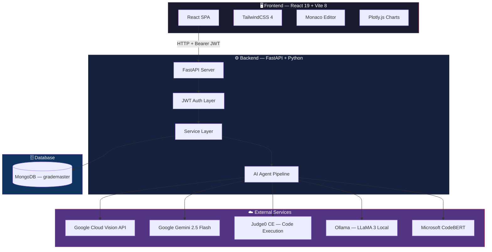
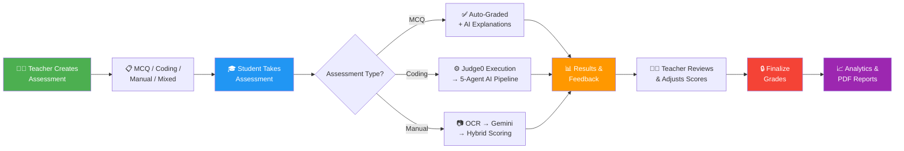

<div align="center">

<!-- Replace with your own banner image -->
<!--  -->

# 🎓 GradeMaster 

### *Intelligent Academic Assessment Platform*

**AI-powered grading system that automates evaluation of MCQ, coding, and handwritten assignments — with plagiarism detection, smart feedback, and analytics.**

[](https://python.org)
[](https://fastapi.tiangolo.com)
[](https://react.dev)
[](https://mongodb.com)
[](https://tailwindcss.com)
[](LICENSE)

[Features](#-features) · [Tech Stack](#-tech-stack) · [Getting Started](#-getting-started) · [Architecture](#%EF%B8%8F-architecture) · [How It Works](#%EF%B8%8F-how-it-works)

</div>

---

## ✨ Features

<table>
<tr>
<td width="50%">

### 📝 Multi-Format Assessments
- **MCQ** — Auto-graded with AI explanations for wrong answers
- **Coding** — In-browser Monaco editor, 5 languages, sandboxed execution
- **Handwritten** — Upload scanned pages → OCR → AI evaluation
- **Mixed** — Combine MCQ + Coding in one exam

</td>
<td width="50%">

### 🤖 AI-Powered Evaluation
- **Google Gemini 2.5 Flash** — Semantic answer scoring & text cleanup
- **CodeBERT** — Code plagiarism detection via vector embeddings
- **Ollama (LLaMA 3)** — Intelligent code fix suggestions & feedback
- **Tree-sitter** — AST-based code complexity analysis

</td>
</tr>
<tr>
<td width="50%">

### 👁️ OCR & Vision Pipeline
- **Google Cloud Vision API** — Handwriting text extraction
- **PyMuPDF** — PDF-to-image conversion at 200 DPI
- **Smart segmentation** — AI maps answers to questions
- **Hybrid scoring** — Keyword matching + AI semantic evaluation

</td>
<td width="50%">

### 📊 Analytics & Reporting
- **Interactive dashboards** — Plotly.js charts for teachers & students
- **PDF reports** — Downloadable student & assessment reports
- **Per-assessment analytics** — Score distributions, class performance
- **AI recommendations** — Teaching insights generated post-deadline

</td>
</tr>
<tr>
<td width="50%">

### 🔒 Role-Based Access Control
- **Admin** — Manages departments, sections, subjects, teacher approvals
- **Teacher** — Creates assessments, reviews AI grades, finalizes scores
- **Student** — Takes exams, views results, tracks performance

</td>
<td width="50%">

### 🛡️ Security & Integrity
- **JWT authentication** with bcrypt password hashing
- **Plagiarism detection** using cosine similarity on code embeddings
- **Answer key protection** — Hidden test cases & correct answers stripped
- **Submission locking** — Finalized grades are immutable

</td>
</tr>
</table>

---

## 🏗️ Architecture

<!-- This Mermaid diagram renders natively on GitHub. Edit the text below to modify it. -->



---

## 🧠 Tech Stack

| Layer | Technology | Purpose |
|:------|:-----------|:--------|
| **Frontend** | React 19, Vite 8, React Router 7 | SPA with fast HMR |
| **Styling** | TailwindCSS 4, Lucide Icons | Utility-first CSS, dark/light themes |
| **Code Editor** | Monaco Editor (VS Code engine) | In-browser coding environment |
| **Charts** | Plotly.js + react-plotly.js | Interactive analytics dashboards |
| **Backend** | FastAPI, Uvicorn (ASGI) | Async Python API server |
| **Database** | MongoDB, Motor (async driver) | Document-based storage |
| **Auth** | python-jose (JWT), bcrypt | Token-based authentication |
| **Validation** | Pydantic v2 | Request/response schema validation |
| **OCR** | Google Cloud Vision API | Handwritten text extraction |
| **AI Evaluation** | Google Gemini 2.5 Flash | Semantic scoring, text cleanup, MCQ explanations |
| **Plagiarism** | Microsoft CodeBERT + PyTorch | 768-dim code embeddings + cosine similarity |
| **Code Execution** | Judge0 CE (public API) | Sandboxed execution (Python, C, C++, Java, JS) |
| **Static Analysis** | Tree-sitter (Python grammar) | AST parsing: loops, nesting, complexity |
| **Code Fixes** | Ollama / LLaMA 3 (local) | AI-generated corrected code + explanations |
| **Feedback** | Ollama / LLaMA 3 (local) | Context-aware student feedback |
| **PDF Reports** | ReportLab | Downloadable student & assessment reports |
| **Image Processing** | Pillow, PyMuPDF (fitz) | Image validation, PDF-to-image conversion |

---

## 📸 Screenshots

<!-- Replace these placeholders with your actual screenshots -->
<!-- Use:  -->

<details>
<summary><b>🏠 Landing Page</b></summary>
<br>

> 📌 *Add your screenshot here:*
> ```
> 
> ```

</details>

<details>
<summary><b>🎓 Student Dashboard</b></summary>
<br>

> 📌 *Add your screenshot here:*
> ```
> 
> ```

</details>

<details>
<summary><b>👨‍🏫 Teacher Dashboard</b></summary>
<br>

> 📌 *Add your screenshot here:*
> ```
> 
> ```

</details>

<details>
<summary><b>📝 Assessment Creation</b></summary>
<br>

> 📌 *Add your screenshot here:*
> ```
> 
> ```

</details>

<details>
<summary><b>💻 Coding Editor</b></summary>
<br>

> 📌 *Add your screenshot here:*
> ```
> 
> ```

</details>

<details>
<summary><b>📊 Analytics & Reports</b></summary>
<br>

> 📌 *Add your screenshot here:*
> ```
> 
> ```

</details>

<details>
<summary><b>🔍 AI Evaluation Results</b></summary>
<br>

> 📌 *Add your screenshot here:*
> ```
> 
> ```

</details>

---

## 🚀 Getting Started

### Prerequisites

| Requirement | Version | Download |
|:------------|:--------|:---------|
| **Node.js** | 18+ | [nodejs.org](https://nodejs.org) |
| **Python** | 3.10+ | [python.org](https://python.org) |
| **MongoDB** | 6.0+ | [mongodb.com](https://www.mongodb.com/try/download/community) |
| **Git** | Latest | [git-scm.com](https://git-scm.com) |

**API Keys Required:**
- [Google Cloud Vision API Key](https://console.cloud.google.com/apis/library/vision.googleapis.com)
- [Google Gemini API Key](https://aistudio.google.com/apikey)
- [Judge0 CE API Key](https://judge0.com) *(optional — works without key on public tier)*
- [Ollama](https://ollama.com) *(optional — install locally for code fix suggestions)*

### 1️⃣ Clone the Repository

```bash
git clone https://github.com/YOUR_USERNAME/GradeMaster-AI.git
cd GradeMaster-AI
```

### 2️⃣ Backend Setup

```bash
# Navigate to backend
cd backend

# Create virtual environment
python -m venv venv

# Activate virtual environment
# Windows:
venv\Scripts\activate
# macOS/Linux:
source venv/bin/activate

# Install dependencies
pip install -r requirements.txt

# Create environment file
cp .env.example .env
```

Edit `.env` with your API keys (see [Environment Variables](#-environment-variables) below).

### 3️⃣ Frontend Setup

```bash
# Navigate to frontend (from project root)
cd frontend

# Install dependencies
npm install
```

### 4️⃣ Start the Application

**Terminal 1 — Backend:**
```bash
cd backend
uvicorn main:app --reload
```
> Backend runs at `http://localhost:8000`
> API docs at `http://localhost:8000/docs`

**Terminal 2 — Frontend:**
```bash
cd frontend
npm run dev
```
> Frontend runs at `http://localhost:5173`

### 5️⃣ First-Time Setup

1. Open `http://localhost:5173` in your browser
2. You'll be redirected to `/setup` to create the **Admin account**
3. Login as Admin → create Departments, Sections, Subjects
4. Register a Teacher account → Admin approves it → Assign to subjects
5. Register a Student account → start taking assessments!

---

## 🔐 Environment Variables

Create a `.env` file in the `backend/` directory:

```env
# ── Database ──
MONGO_URI=mongodb://localhost:27017

# ── Authentication ──
JWT_SECRET=your-super-secret-key-change-in-production
JWT_ALGORITHM=HS256

# ── Google Cloud Vision (OCR) ──
GOOGLE_VISION_API_KEY=your-google-vision-api-key

# ── Google Gemini (AI Evaluation) ──
GEMINI_API_KEY=your-gemini-api-key

# ── Judge0 CE (Code Execution) ──
JUDGE0_API_URL=https://ce.judge0.com
JUDGE0_API_KEY=your-judge0-api-key

# ── Ollama (Local LLM — Optional) ──
OLLAMA_MODEL=llama3
OLLAMA_HOST=http://localhost:11434
```

| Variable | Required | Description |
|:---------|:---------|:------------|
| `MONGO_URI` | ✅ | MongoDB connection string |
| `JWT_SECRET` | ✅ | Secret key for signing JWT tokens |
| `GEMINI_API_KEY` | ✅ | Google Gemini API for AI evaluation |
| `GOOGLE_VISION_API_KEY` | ✅ | Google Vision API for OCR |
| `JUDGE0_API_URL` | ⚠️ | Judge0 endpoint (has free public tier) |
| `JUDGE0_API_KEY` | ❌ | Optional — for higher rate limits |
| `OLLAMA_MODEL` | ❌ | Local LLM model (fallback if unavailable) |
| `OLLAMA_HOST` | ❌ | Ollama server URL |

---

## 👥 User Roles

<table>
<tr>
<td align="center" width="33%">

### 🔑 Admin
*System Administrator*

- Create departments, sections, subjects
- Approve teacher registrations
- Assign teachers to subjects & sections
- System-wide oversight
- **Only ONE admin** can exist

</td>
<td align="center" width="33%">

### 👨‍🏫 Teacher / Faculty
*Assessment Manager*

- Create MCQ, Coding, Manual, Mixed assessments
- Review AI-evaluated submissions
- Adjust scores & add feedback
- Finalize grades (immutable lock)
- View analytics & download reports
- **Requires Admin approval**

</td>
<td align="center" width="33%">

### 🎓 Student
*Assessment Taker*

- Self-register (auto-approved)
- Take MCQ, Coding & Handwritten exams
- Upload scanned handwritten answers
- View AI feedback & scores
- Track performance via analytics
- Download personal reports

</td>
</tr>
</table>

---

## 📡 API Overview

The backend exposes **46 RESTful endpoints** organized into 8 route modules:

| Module | Prefix | Endpoints | Description |
|:-------|:-------|:---------:|:------------|
| **Auth** | `/api/auth` | 3 | Signup, login, current user |
| **Admin** | `/api/admin` | 11 | Departments, sections, subjects, teacher management |
| **Assessments** | `/api` | 5 | Create/list/detail assessments, question review |
| **Submissions** | `/api` | 14 | Submit answers, evaluate, view results |
| **Teacher Review** | `/api/teacher` | 4 | Review scores, finalize, audit history |
| **OCR Pipeline** | `/api` | 3 | Upload handwritten, process text, evaluate |
| **Analytics** | `/api/analytics` | 4 | Dashboards, per-assessment reports |
| **Reports** | `/api/reports` | 2 | PDF report downloads |

> 📖 Full API documentation is auto-generated at `http://localhost:8000/docs` (Swagger UI)

---

## 📁 Project Structure

```
GradeMaster-AI/
├── 📂 backend/                    # FastAPI Backend
│   ├── main.py                    # Entry point (uvicorn compatibility)
│   ├── requirements.txt           # Python dependencies
│   ├── .env                       # Environment variables
│   ├── 📂 uploads/                # Uploaded handwritten files
│   └── 📂 app/
│       ├── main.py                # FastAPI app + CORS + router registration
│       ├── database.py            # MongoDB connection (Motor async)
│       ├── 📂 schemas/            # Pydantic request/response models
│       │   ├── user_schema.py     # User, Login, Token schemas
│       │   ├── assessment_schema.py # Assessment + question schemas
│       │   ├── submission_schema.py # MCQ, Coding, Manual submission schemas
│       │   └── academic_schema.py # Department, Section, Subject schemas
│       ├── 📂 routes/             # API route handlers
│       │   ├── auth_routes.py     # /api/auth/*
│       │   ├── admin_routes.py    # /api/admin/*
│       │   ├── assessment_routes.py # Assessment CRUD
│       │   ├── submission_routes.py # Submission management
│       │   ├── teacher_routes.py  # Review & finalization
│       │   ├── ocr_routes.py      # Handwritten pipeline
│       │   ├── analytics_routes.py # Dashboards & reports
│       │   └── health.py          # Health check
│       └── 📂 services/           # Business logic
│           ├── auth_service.py    # JWT, bcrypt, user CRUD
│           ├── assessment_service.py # Assessment lifecycle
│           ├── submission_service.py # Submission processing
│           ├── evaluation_service.py # Coding evaluation orchestrator
│           ├── ocr_service.py     # Google Vision OCR
│           ├── text_processing_service.py # Gemini text cleanup
│           ├── manual_evaluation_service.py # Keyword + AI scoring
│           ├── review_service.py  # Teacher review workflow
│           ├── judge0_service.py  # Code execution via Judge0
│           ├── analytics_service.py # Dashboard data aggregation
│           ├── pdf_service.py     # PDF report generation
│           ├── assessment_report_service.py # Per-assessment reports
│           └── 📂 agents/         # AI Agent Pipeline
│               ├── agent_pipeline.py # Orchestrator (5 agents)
│               ├── submission_analysis_agent.py # Metadata analysis
│               ├── semantic_plagiarism_agent.py # CodeBERT embeddings
│               ├── plagiarism_agent.py # Length-based heuristic
│               ├── ast_analysis_agent.py # Tree-sitter AST parsing
│               ├── bug_detection_agent.py # Enhanced bug classifier
│               ├── bug_agent.py   # Basic bug detection
│               ├── llm_code_fix_agent.py # Ollama code correction
│               ├── code_fix_agent.py # Rule-based fix suggestions
│               └── feedback_agent.py # LLM feedback generation
│
├── 📂 frontend/                   # React Frontend
│   ├── index.html                 # HTML entry point
│   ├── package.json               # Node dependencies
│   ├── vite.config.js             # Vite configuration
│   └── 📂 src/
│       ├── main.jsx               # React root + BrowserRouter
│       ├── App.jsx                # Route definitions + auth guards
│       ├── index.css              # Global styles + design tokens
│       ├── 📂 lib/
│       │   ├── api.js             # API client (fetch wrappers)
│       │   └── 📂 context/
│       │       └── AppContext.jsx  # Auth state + toast notifications
│       ├── 📂 components/         # Reusable UI components
│       │   ├── Navbar.jsx         # Navigation bar
│       │   ├── Sidebar.jsx        # Dashboard sidebar
│       │   ├── Button.jsx, Card.jsx, Modal.jsx, Input.jsx
│       │   ├── Table.jsx, Tabs.jsx, Badge.jsx, Toast.jsx
│       │   ├── CodeEditor.jsx     # Monaco editor wrapper
│       │   └── ResultCard.jsx, SubmissionCard.jsx, Loader.jsx
│       └── 📂 pages/
│           ├── Landing.jsx, Login.jsx, Signup.jsx, AdminSetup.jsx
│           ├── 📂 admin/          # Admin pages (6 pages)
│           ├── 📂 teacher/        # Teacher pages (11 pages)
│           └── 📂 student/        # Student pages (9 pages)
│
└── README.md                      # This file
```

---

## 🛠️ How It Works

<!-- This Mermaid diagram renders natively on GitHub. Edit the text below to modify it. -->



### The Full Pipeline

<details>
<summary><b>📝 MCQ Flow</b></summary>

1. Student selects answers and submits
2. Backend instantly compares with correct options
3. Score calculated: `correct_answers × marks_per_question`
4. **Gemini AI** generates educational explanations for wrong answers
5. Results returned immediately to the student

</details>

<details>
<summary><b>💻 Coding Flow</b></summary>

1. Student writes code in Monaco Editor → submits
2. Teacher triggers evaluation → code sent to **Judge0 CE** sandbox
3. Each test case executed, output compared with expected
4. **5-Agent AI Pipeline** runs:
   - 🔍 Submission Analysis (metadata)
   - 🛡️ Plagiarism Detection (**CodeBERT** — 768-dim vectors, cosine similarity)
   - 🐛 Bug Detection (classify error type from test results + AST)
   - 🔧 Code Fix (**Ollama/LLaMA 3** — generates corrected code)
   - 💬 Feedback (**Ollama/LLaMA 3** — human-readable feedback)
5. Teacher reviews AI score → adjusts → finalizes

</details>

<details>
<summary><b>📄 Handwritten / Manual Flow</b></summary>

1. Student uploads scanned image/PDF
2. **Phase 1:** Google Cloud Vision extracts text (OCR)
3. **Phase 2:** Gemini cleans OCR errors + segments answers per question
4. **Phase 3:** Hybrid evaluation per question:
   - Keyword matching: `(matched_keywords / total) × marks`
   - AI semantic scoring: Gemini evaluates correctness, completeness, clarity
   - Final = average of both scores
5. Teacher reviews → adjusts score → finalizes

</details>

---

## 🤝 Contributing

Contributions are welcome! Here's how:

1. **Fork** the repository
2. **Create** a feature branch: `git checkout -b feature/amazing-feature`
3. **Commit** your changes: `git commit -m 'Add amazing feature'`
4. **Push** to the branch: `git push origin feature/amazing-feature`
5. **Open** a Pull Request


---

<div align="center">

**⭐ Star this repo if you found it useful!**

</div>
