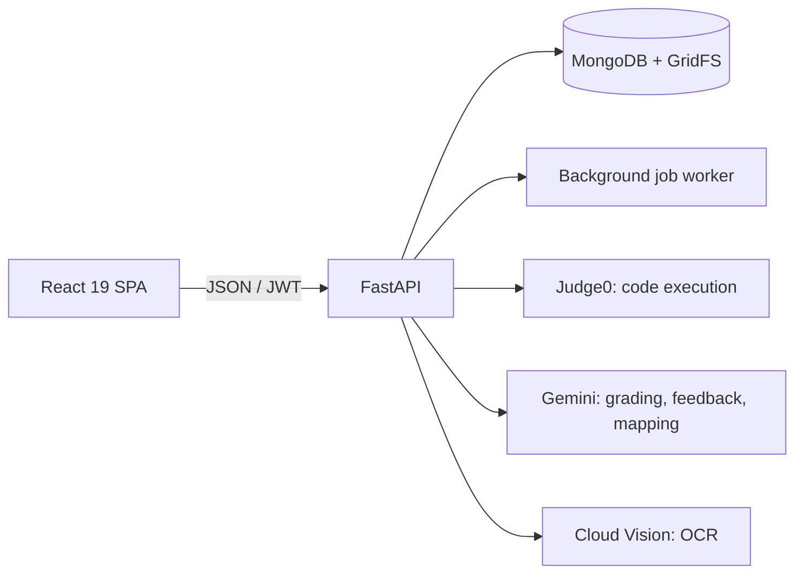

<div align="center">

# GradeMaster AI

**AI-assisted assessment for MCQ, coding and handwritten work, with the teacher in control of every final grade.**

[](https://python.org)
[](https://fastapi.tiangolo.com)
[](https://react.dev)
[](https://mongodb.com)
[](#testing)

**Live:** https://grademaster-web.onrender.com (free hosting; the first load after idle can take about a minute)

[Features](#features) · [Architecture](#architecture) · [Quick start](#quick-start) · [Deployment](#deployment) · [Documentation](#documentation)

</div>

---

## What it does

GradeMaster runs three kinds of assessment in one platform and evaluates them with automated help:

| Type | How it is evaluated |
|---|---|
| **MCQ** | Graded instantly and exactly. Results are released immediately or after closing, with AI explanations for wrong answers |
| **Coding** | Student code runs in the Judge0 sandbox against public and hidden tests. Partial marks, bug analysis, a structural plagiarism check and AI feedback with a minimal fix |
| **Mixed** | MCQ and coding in one exam with one timer and one submit |
| **Handwritten** | Photos or PDFs are read by OCR (Cloud Vision, with a Gemini fallback) and mapped to questions. The student corrects the text, then rubric-aware AI and keyword coverage pre-grade it |

Automated scores are **suggestions**. Coding and handwritten grades reach students only after a teacher reviews and
finalises them. Uncertainty is flagged rather than hidden: AI outages, low OCR confidence, AI/keyword disagreement,
suspected prompt injection and possible plagiarism. Flagged work is ordered in a risk-ranked review queue.

## Features

**For teachers**
- Assessment builder for MCQ, coding, handwritten and mixed assessments, with a validity checklist and drafts
- Question bank (personal and shared), import from past assessments, and AI-drafted questions you edit before use
- Review screens with evidence: test results, rubric quotes, matched and missed keywords, original answer sheets
- Code similarity matrix and side-by-side comparison with matching lines highlighted
- Class analytics from finalised results: recency-weighted topic mastery, hardest questions, recurring mistakes and students who may need support; PDF reports

**For students**
- Timed exams with personal deadlines synced to the server clock, autosaved drafts and auto-submit
- Optional per-student shuffling of questions and options
- Released results with explanations and feedback, plus a progress page with focus topics and strengths

**For administrators**
- Departments, sections, subjects (with topics) and teaching assignments
- Staff accounts, faculty approvals, and activation/deactivation with immediate session revocation
- Audit log and system health

**Security**
- Strong-secret enforcement, JWT with token versioning, and ownership checks on every resource
- Per-IP rate limits, security headers, a strict Content-Security-Policy and protected first-admin setup
- Student text is fenced and screened before it reaches the AI grader

## Architecture



| Layer | Stack |
|---|---|
| Frontend | React 19, Vite 8, Tailwind CSS v4 (light/dark tokens), react-router 7, Monaco (self-hosted), SVG charts |
| Backend | FastAPI, Pydantic v2, Motor (async MongoDB), python-jose, bcrypt, httpx |
| Data | MongoDB with versioned migrations; uploads in GridFS; Mongo-backed job queue |
| AI / services | Google Gemini 2.5 Flash, Google Cloud Vision (optional), Judge0 CE; optional Ollama and CodeBERT |
| Ops | Docker (non-root), Render blueprint, MongoDB Atlas |

## Quick start

Prerequisites: Python 3.13, Node.js 22, and MongoDB running locally (or an Atlas connection string).

```bash
# 1. Backend
cd backend
python -m venv .venv
.venv/Scripts/activate                  # macOS/Linux: source .venv/bin/activate
pip install -r requirements.txt -r requirements-dev.txt
cp .env.example .env                    # then set JWT_SECRET (generate one below) and optionally GEMINI_API_KEY
python -c "import secrets; print(secrets.token_urlsafe(48))"
uvicorn app.main:app --reload --port 8000

# 2. Frontend (new terminal)
cd frontend
npm ci
npm run dev                             # http://localhost:5173
```

Open **http://localhost:5173/setup** to create the administrator, then add a department, section, subject and
teacher. API docs (development only) are at http://localhost:8000/api/docs.

The app works without a Gemini key. MCQ grading and code execution are unaffected. AI-dependent steps fall back:
handwritten answers get keyword-only provisional scores flagged for the teacher, and code feedback becomes rule-based.

## Testing

```bash
cd backend && pytest -q        # 63 tests: auth, authorization, exams, evaluation, review, analytics, hardening
cd frontend && npm test        # 19 tests: API client, route guards, charts, exam timer, formatters
```

Backend tests send real HTTP requests to the app, backed by a disposable `grademaster_test` database.

## Deployment

The repository includes a production [Dockerfile](backend/Dockerfile) and a [Render blueprint](render.yaml)
(API plus static frontend) for use with MongoDB Atlas. Follow **[docs/DEPLOYMENT.md](docs/DEPLOYMENT.md)** for
step-by-step account setup, environment variables, first sign-in and verification.

## Documentation

| Document | Contents |
|---|---|
| [docs/MASTER_DOCUMENTATION.md](docs/MASTER_DOCUMENTATION.md) | Full technical documentation: architecture, data model, all 76 API endpoints, workflows, algorithms, security, testing |
| [docs/DEPLOYMENT.md](docs/DEPLOYMENT.md) | Hosting guide and environment reference |
| [docs/AUDIT_REPORT.md](docs/AUDIT_REPORT.md) | Audit of the original codebase and how the findings were addressed |
| [PROJECT_PROGRESS.md](PROJECT_PROGRESS.md) | Current status and next steps |
| [RECOVERY_GUIDE.md](RECOVERY_GUIDE.md) | Backup and restore procedure |

## Project structure

```
backend/     FastAPI app (routes → services → MongoDB), AI gateway, plagiarism engine, job worker, tests
frontend/    React app: design system, admin/teacher/student portals, exam views, tests
docs/        Master documentation, deployment guide, audit report
render.yaml  Deployment blueprint
```
