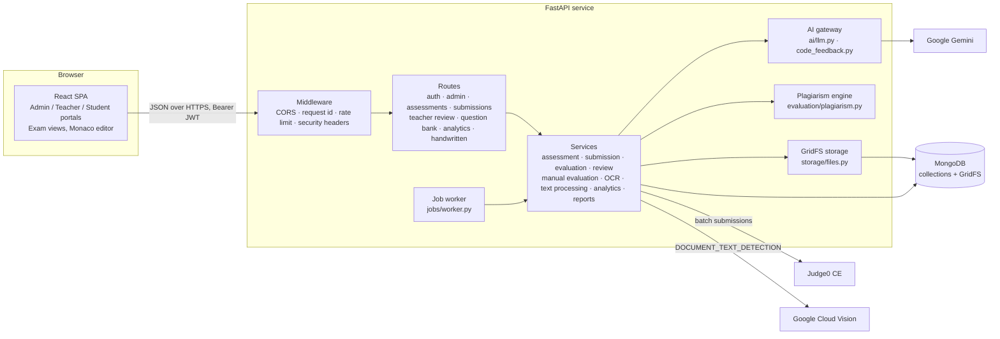
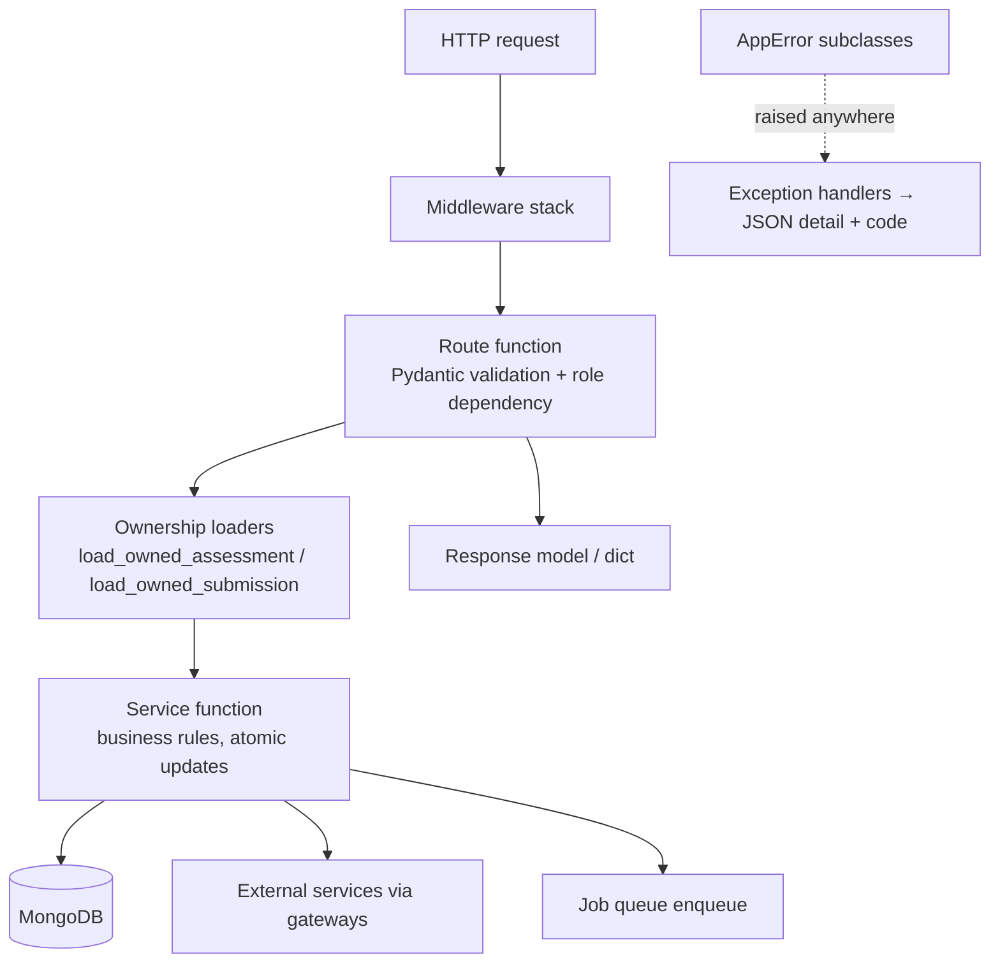
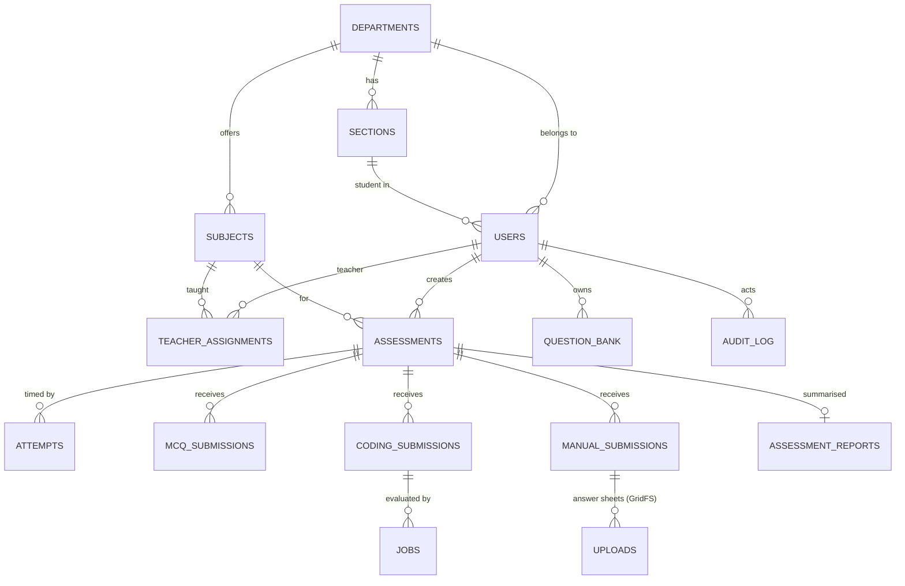
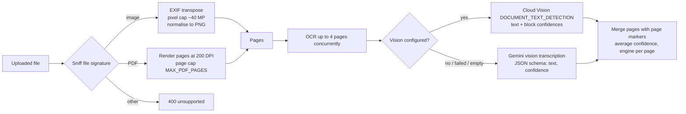
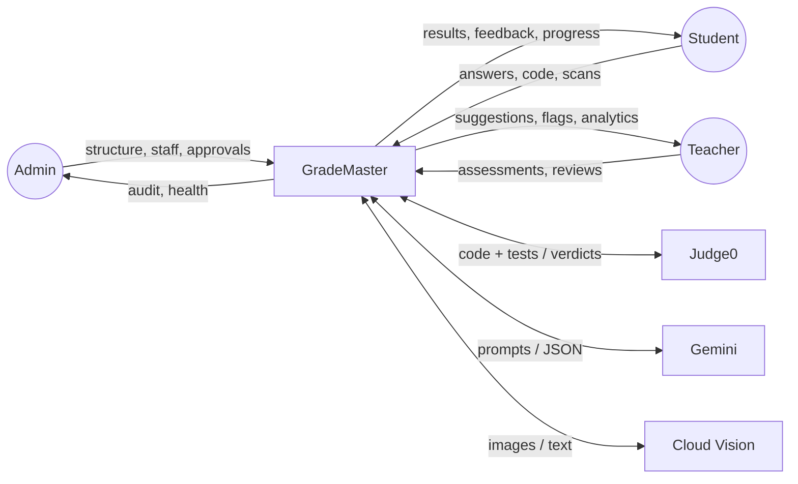
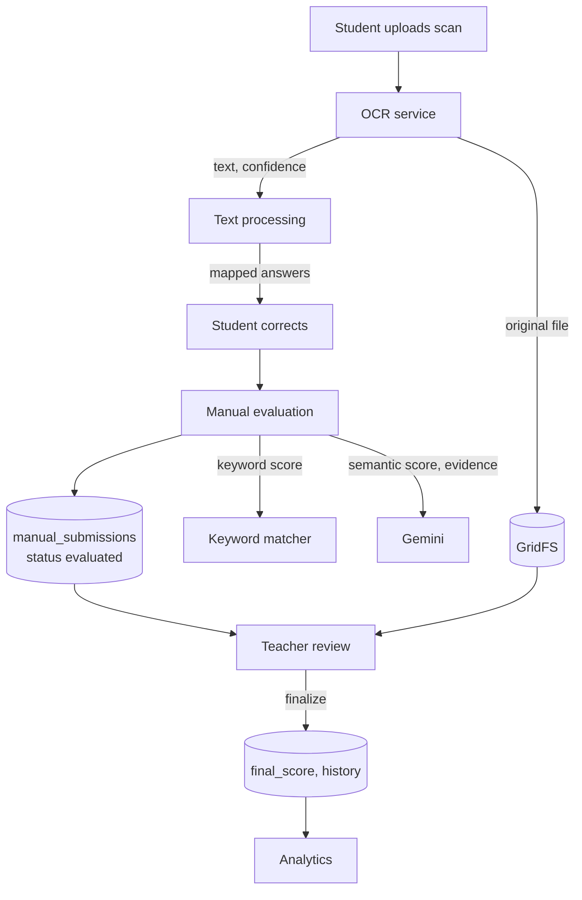
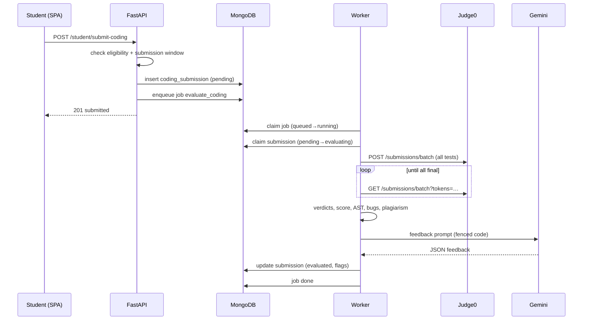
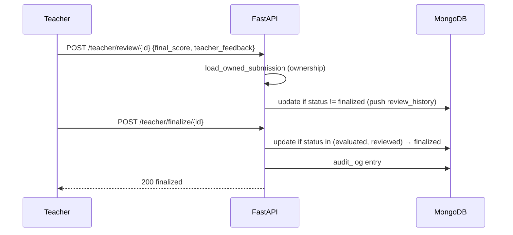
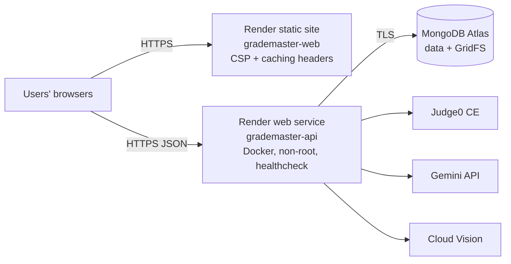

# GradeMaster AI: Master Technical Documentation

**AI-assisted assessment and evaluation for MCQ, coding and handwritten work, with the teacher in control of every final grade.**

| | |
|---|---|
| Version | 2.0 (transformation branch `feature/gradmaster-transformation`) |
| Document date | 25 November 2026 |
| Repository | `github.com/KrishnaManoharReddy907/GradeMaster-AI` |
| Status | Implemented and tested locally; deployment configuration built and verified locally; live deployment pending the owner's hosting accounts |

> **How to read this document.** Sections 1–6 explain *why* the system exists. Sections 7–17 describe *how it is
> built*. Sections 18–31 walk through *each feature and its internal working*. Sections 32–49 cover algorithms,
> security, testing, deployment and operations. Every statement describes the implemented system; where something is
> configured but not yet exercised in production, it is labelled **unverified**.

---

## Contents

1. Project title and overview · 2. Problem statement · 3. Existing problems in academic assessment · 4. Motivation ·
5. Objectives · 6. Proposed solution · 7. System architecture · 8. Architecture diagrams · 9. Technology stack ·
10. Folder structure · 11. Major modules · 12. Frontend architecture · 13. Backend architecture ·
14. Database architecture · 15. Collections, fields, relationships and constraints · 16. API documentation ·
17. Authentication and authorization · 18. Admin module · 19. Teacher module · 20. Student module ·
21. MCQ workflow · 22. Coding workflow · 23. Handwritten workflow · 24. OCR pipeline ·
25. Text cleaning and segmentation · 26. Hybrid evaluation methodology · 27. Code execution and sandbox ·
28. Bug analysis · 29. Plagiarism detection · 30. Feedback generation · 31. Analytics and reporting ·
32. New features · 33. Algorithms · 34. Data-flow diagrams · 35. Sequence diagrams · 36. Security architecture ·
37. Error handling and fallbacks · 38. Testing strategy and results · 39. Performance and scalability ·
40. Deployment architecture · 41. Environment configuration · 42. Repository structure ·
43. Installation and execution · 44. User guide · 45. Limitations · 46. Future enhancements ·
47. Challenges and solutions · 48. Technical decisions · 49. End-to-end workflows · 50. Conclusion

---

## 1. Project title and overview

**GradeMaster AI** is a web platform that lets an institution run three kinds of assessment in one place and evaluate
them with automated help:

* **Multiple-choice (MCQ)** tests are graded instantly and exactly. Students get optional AI explanations of their mistakes.
* **Coding** assignments run student programs against teacher test cases in a sandbox (Judge0). The platform awards
  partial marks, analyses code structure, detects likely bugs and structural plagiarism, and drafts feedback.
* **Handwritten** (descriptive) answers are photographed or scanned, read by OCR, mapped to questions, and pre-graded
  by combining rubric-aware semantic scoring (Gemini) with keyword coverage.

Three portals serve three roles. **Administrators** manage the institution's structure and staff. **Teachers**
author, review and finalise. **Students** take assessments and track their progress. The design principle throughout
is *"AI suggests, teachers decide"*: automated scores are drafts. Coding and handwritten grades become visible to a
student only after a teacher finalises them, and every review leaves an audit trail.

## 2. Problem statement

Teachers spend a disproportionate share of their time on grading. Coding work requires running every submission.
Handwritten answers need careful reading against a model answer. Copying is hard to spot across a class. Results
arrive late and say little about *what* a student should work on. Existing tools usually solve one of these
(an online quiz tool, an online judge, an OCR app) but not together, and rarely with the teacher's review built in.

**GradeMaster addresses the problem:** *How can a single platform evaluate MCQ, coding and handwritten assessments
quickly and consistently, explain its judgements, detect academic-integrity risks, and turn results into actionable
insight, while keeping the teacher responsible for every final grade?*

## 3. Existing problems in academic assessment

| Problem | Effect | How GradeMaster responds |
|---|---|---|
| Manual grading of programs | Hours spent compiling and running code; inconsistent partial credit | Sandboxed batch execution, proportional partial marks, per-test results |
| Subjective marking of descriptive answers | Inconsistency between markers and over time | Rubric criteria with evidence quotes, keyword coverage, a fixed weighting, disagreement flags |
| Slow feedback | Students learn little from a bare score weeks later | Instant MCQ results (if released), AI explanations, code feedback, per-question remarks |
| Copying in code | Renamed variables defeat naive comparison | Token-normalised winnowing fingerprints with side-by-side matched lines |
| Results without insight | Teachers cannot see weak topics | Topic mastery (recency-weighted), hardest questions, recurring mistakes, at-risk students |
| Fragmented tools | Data spread across apps | One platform, one database, consistent roles |
| Unaccountable automation | Black-box AI grades erode trust | Every AI score is a suggestion; teacher review and finalisation with history |

## 4. Motivation

Generative and vision models can now read handwriting and judge free text reasonably well. Online judges make code
execution cheap. What was missing was a system that **combines them responsibly**. It must expose uncertainty
instead of hiding it, protect itself against students who try to manipulate an AI grader, degrade gracefully when an
external service fails, and give the teacher a fast review loop. GradeMaster is built around that loop.

## 5. Project objectives

1. Evaluate MCQ, coding and handwritten assessments within one consistent workflow.
2. Keep teachers in control: AI output is a draft; finalisation is explicit, recorded and (for manual work) immutable.
3. Make automated judgements explainable (test-level results, rubric evidence, matched keywords, flags).
4. Detect integrity risks (structural code similarity, prompt-injection attempts).
5. Turn finalised results into teaching insight (topics, hardest questions, recurring mistakes, at-risk students).
6. Be secure by default (verified identities, ownership checks on every resource, rate limits, no secrets in code).
7. Stay usable when AI or execution services are down (fallbacks plus explicit flags).
8. Be deployable by a small institution at low or no cost.

## 6. Proposed solution

A **React single-page application** talks to a **FastAPI** service over a JSON API. The service stores everything in
**MongoDB**, including uploaded answer sheets via GridFS. It delegates three specialised jobs to external services:
**Judge0** (code execution), **Google Cloud Vision** (OCR; optional) and **Google Gemini** (semantic grading, OCR
mapping, explanations, feedback, question drafting). Slow work such as code evaluation runs in a **background job
queue** stored in MongoDB, so requests stay fast and work survives restarts. A **review layer** sits on top of every
automated result: flags explain why an item deserves attention, the review queue orders items by risk, and
finalisation publishes the grade.

---

## 7. Complete system architecture

The system has four tiers:

1. **Presentation**: React 19 SPA (three portals plus full-screen exam views), served as static files.
2. **Application**: FastAPI app with layered structure: *routes* (HTTP, validation, authorization) → *services*
   (business rules) → *data access* (Motor). Cross-cutting *core* modules handle config, security, errors and
   observability. An in-process *worker* drains the job queue.
3. **Data**: MongoDB with 16 collections plus a GridFS bucket (`uploads`), versioned migrations and indexes.
4. **External intelligence**: Judge0 CE (execution), Gemini (LLM and vision), Cloud Vision (OCR). Optional local
   alternatives: Ollama (LLM) and CodeBERT (semantic code similarity).

## 8. Architecture diagrams

### 8.1 Component view



### 8.2 Layering inside the API



## 9. Technology stack and justification

| Layer | Technology | Why |
|---|---|---|
| Frontend framework | React 19, react-router 7 | Mature ecosystem, lazy routes, concurrent rendering |
| Build | Vite 8 | Fast dev server, code splitting, small bundles (main bundle ≈ 201 KB, 64 KB gzip) |
| Styling | Tailwind CSS v4 with CSS-variable design tokens | One token set drives light and dark themes; consistent components |
| Code editor | Monaco (bundled locally) | The VS Code editor; self-hosted so exams don't depend on a CDN |
| Icons / fonts | lucide-react; Inter and JetBrains Mono (self-hosted) | No third-party requests at runtime |
| Charts | Hand-written SVG components | Small, accessible (every chart has a table view), themeable |
| API | FastAPI, Pydantic v2, pydantic-settings | Typed validation, automatic OpenAPI, async I/O |
| Database driver | Motor (async MongoDB) | Non-blocking DB access matching FastAPI's async model |
| Database | MongoDB (local or Atlas) + GridFS | Assessments are naturally nested documents; GridFS keeps files with the data. The original project already used MongoDB, so no migration of technology |
| Auth | python-jose (JWT HS256), bcrypt | Stateless sessions with server-side revocation via a token version |
| Code execution | Judge0 CE (batch API) | Battle-tested sandbox with CPU and memory limits; no infrastructure to run |
| LLM / vision | Google Gemini 2.5 Flash via `google-genai` | Structured JSON output with schemas, vision input, low cost |
| OCR | Google Cloud Vision (optional) | High-quality handwriting OCR with confidence scores |
| PDF | ReportLab; PyMuPDF for reading PDFs | Server-side report generation; rendering PDF pages for OCR |
| Code structure | tree-sitter (Python) | Precise AST metrics for Python; heuristics for other languages |
| Tests | pytest + pytest-asyncio + httpx ASGI; Vitest + Testing Library | Real HTTP-level backend tests against a test DB; component tests in jsdom |
| Packaging | Docker (python:3.13-slim), Render blueprint | Reproducible production image; one-file infrastructure definition |

## 10. Complete folder structure

```
GradeMaster-AI/
├── backend/
│   ├── app/
│   │   ├── main.py                # app factory: middleware, routers, lifespan (DB, migrations, worker)
│   │   ├── database.py            # Motor client, GridFS access, versioned migrations 001–004
│   │   ├── core/                  # config, security (JWT/bcrypt), deps (roles + ownership), errors, observability
│   │   ├── routes/                # HTTP layer: auth, admin, assessment, submission, teacher, question_bank, analytics, ocr, health
│   │   ├── schemas/               # Pydantic request/response models (user, academic, assessment, submission)
│   │   ├── services/              # business logic (see §11)
│   │   │   └── agents/            # code analysis helpers: AST metrics, bug detection, fix hints, feedback, CodeBERT
│   │   ├── ai/                    # llm.py (Gemini/Ollama gateway, JSON, injection defence), code_feedback.py
│   │   ├── evaluation/            # plagiarism.py (winnowing engine)
│   │   ├── jobs/                  # worker.py (Mongo-backed queue), handlers.py
│   │   └── storage/               # files.py (GridFS uploads)
│   ├── tests/                     # pytest suites + fixtures (conftest.py)
│   ├── Dockerfile, .dockerignore
│   ├── requirements.txt           # production deps (pinned)
│   ├── requirements-ml.txt        # optional: torch/transformers (CodeBERT), ollama
│   ├── requirements-dev.txt       # pytest etc.
│   └── .env.example               # every setting, documented
├── frontend/
│   ├── index.html, public/        # icon, theme-init.js
│   ├── src/
│   │   ├── main.jsx, App.jsx      # providers, lazy routes, error boundary
│   │   ├── index.css              # design tokens (light/dark), component classes
│   │   ├── lib/                   # api client, auth context, theme/toasts, hooks, utils, catalog
│   │   ├── components/            # ui/ primitives + domain badges, AppShell, charts, code editor, guards, markdown
│   │   └── pages/                 # public/, shared/, admin/, teacher/ (+ builder/), student/
│   ├── vite.config.js, vitest.config.js, package.json
├── docs/                          # AUDIT_REPORT.md, DEPLOYMENT.md, MASTER_DOCUMENTATION.md
├── render.yaml                    # deployment blueprint (API + static site)
├── PROJECT_PROGRESS.md, PROJECT_MASTER_CONTEXT.md, IMPLEMENTATION_ROADMAP.md, RECOVERY_GUIDE.md
└── README.md
```

## 11. Every major module and its responsibilities

### 11.1 Backend core (`backend/app/core`)

| Module | Responsibility |
|---|---|
| `config.py` | Single source of configuration (environment + `.env`). Refuses to start with a missing/weak `JWT_SECRET` (< 32 chars or a known default). Exposes `is_production`, `api_docs_enabled`, CORS list, upload limits. |
| `security.py` | bcrypt password hashing; JWT creation/verification with claims `sub`, `role`, `tv` (token version), `exp`. |
| `deps.py` | FastAPI dependencies: `get_current_user` (checks user exists, `is_active`, token version), `require_admin`, `require_staff` (approved faculty/teacher/HOD, or admin), `require_student`; ownership loaders `load_owned_assessment`, `load_owned_submission`, `ensure_owns_assessment`; `to_object_id` (malformed ids → 404, never 500). |
| `errors.py` | `AppError` hierarchy (BadRequest, Unauthorized, Forbidden, NotFound, Conflict, PayloadTooLarge, Unprocessable, TooManyRequests, ServiceUnavailable) and handlers producing `{detail, code}`; validation errors → 422 with `errors[]`. |
| `observability.py` | Structured logging; `RequestContextMiddleware` (X-Request-ID, access log with timing); `RateLimitMiddleware` (sliding window per client IP and route rule, proxy-aware, self-pruning); `SecurityHeadersMiddleware`. |

### 11.2 Backend services (`backend/app/services`)

| Service | Responsibility |
|---|---|
| `auth_service` | Sign-up (students auto-approved; faculty pending), first-admin bootstrap, staff creation by admin, login (pending/inactive checks), password change (bumps token version). |
| `academic_service` | Departments, sections, subjects (with topic lists), teacher assignments (subject + sections, with year/department consistency checks), approvals, activation. |
| `assessment_service` | Create (server-computed totals), list, update schedule, delete; status calculation (upcoming/active/ended); student eligibility; student-safe serialization (no keys, hidden tests or model answers; optional per-student shuffle); timed attempts and personal deadlines; submission window with 2-minute grace; result-release rule. |
| `submission_service` | MCQ scoring and storage, coding submission storage (auto-queues evaluation), student status views that hide scores until released, the student's submission list. |
| `evaluation_service` | Coding evaluation: atomic claim, Judge0 batch run, partial marks, structure analysis, bug detection, plagiarism check (symmetric), AI feedback, flags; batch queuing. |
| `judge0_service` | Batch submit + poll with CPU/memory limits; output normalisation and comparison; RapidAPI header support. |
| `review_service` | Teacher review and finalisation of coding (per submission or whole assessment) and manual work (per-question scores, immutability after finalisation, review history). |
| `ocr_service` | File sniffing, EXIF orientation, decompression-bomb limits, PDF page rendering (200 DPI), Vision OCR with confidence, Gemini transcription fallback, 4 pages in parallel. |
| `text_processing_service` | Mapping OCR text to questions: AI mapping with a JSON schema and a length guard, regex segmentation fallback, warnings. |
| `manual_evaluation_service` | Keyword coverage (stemming, synonyms), Gemini rubric or holistic scoring with evidence and confidence, 0.7/0.3 combination, uncertainty flags. |
| `analytics_service` | Normalised result rows from finalised work; teacher dashboard (stats, distribution, trend, topic mastery, at-risk students, hardest questions, recurring mistakes) and student dashboard; student profile for teachers. |
| `assessment_report_service`, `pdf_service` | Cached per-assessment insight reports; PDF reports for students and assessments. |
| `question_bank_service` | Reusable question bank (dedupe by fingerprint, sharing, usage counts), import from assessments, AI question drafting with validation. |
| `audit_service` | Append-only audit entries that never break the audited action; searchable list. |
| `system_service` | Admin system-health snapshot (DB, AI/OCR/Judge0 configuration, queue depth). |

### 11.3 Other backend packages

| Package | Responsibility |
|---|---|
| `ai/llm.py` | One gateway for LLM calls: Gemini (async) or Ollama; retries with exponential backoff on transient errors; JSON-schema output; image input; `fence_untrusted` and `detect_prompt_injection` for student text. |
| `ai/code_feedback.py` | AI code feedback (summary, mistake, minimal fix, corrected code, quality notes) with a rule-based fallback; reports its `source`. |
| `evaluation/plagiarism.py` | Language-aware normalisation, k-gram winnowing fingerprints, similarity, matched line ranges, pairwise matrix. |
| `jobs/worker.py`, `jobs/handlers.py` | Mongo-backed queue with de-duplication, concurrency 2, 2 attempts, crash recovery; handlers `evaluate_coding`, `mcq_explanations`. |
| `storage/files.py` | GridFS bucket `uploads`: save with owner metadata, stream, attach to a submission (only the uploader's own files). |
| `services/agents/*` | AST metrics (tree-sitter for Python), test-driven bug detection, fix hints, feedback formatting, optional CodeBERT similarity. |

### 11.4 Frontend modules (`frontend/src`)

| Module | Responsibility |
|---|---|
| `lib/api.js` | Base URL, bearer token, error normalisation (`ApiError` with status/code), 401 → sign-out, file download helpers; typed helpers for every endpoint. |
| `lib/auth.jsx` | Auth context (current user, sign-in/out), role → home mapping. |
| `lib/ui-state.jsx` | Theme provider (light/dark/system) and toasts. |
| `lib/hooks.js` | `useAsync`, `useAction`, `useNow`, `usePersistentState` (drafts), `useJobPoll`, `useDocumentTitle`. |
| `components/ui/*` | Design-system primitives (Button, Card, Field, Select, Modal, Table, Tabs, …) and domain badges (type, status, flags, score, mastery). |
| `components/charts.jsx` | Column, line and bar-list charts with tooltips and a Chart/Table toggle. |
| `components/code.jsx`, `monaco-setup.js` | Lazy Monaco editor (bundled), read-only code view with highlighted lines. |
| `components/guards.jsx` | `RequireRole` and `PublicOnly` route guards. |
| `components/AppShell.jsx` | Sidebar navigation per portal, mobile drawer, theme toggle, user menu. |
| `pages/*` | Screens for each portal (see §18–20). |

## 12. Frontend architecture

* **Routing.** `App.jsx` declares lazy routes grouped by portal. Each portal is wrapped in `RequireRole`, which
  redirects signed-out users to `/login` (remembering where they were going) and users of another role to their own
  home. Exam screens (`/student/take/{mcq|coding|handwritten}/:id`) render outside the portal shell for a distraction-free view.
* **State.** Server state is fetched per screen through `useAsync` (loading/error/reload) and mutated through
  `useAction`. Global state is limited to auth, theme and toasts. Exam drafts persist in `localStorage` via
  `usePersistentState`, so a refresh does not lose code or answers.
* **Design system.** `index.css` defines semantic tokens (`--canvas`, `--surface`, `--ink`, `--brand`, status colours,
  chart series) for light and dark themes; Tailwind v4 maps them to utilities via `@theme inline`. The theme is applied
  before first paint by `public/theme-init.js`.
* **Data visualisation.** Charts are SVG components with thin marks, recessive grids, hover tooltips and an
  always-available table view (accessibility and contrast relief). Count axes use whole-number ticks.
* **Code splitting.** Each page is a separate chunk; Monaco (≈ 716 KB gzip) loads only on the coding exam.
* **Error handling.** An error boundary catches render failures; API errors surface as inline callouts or toasts
  with the server's message; a 401 clears the token and returns to sign-in.
* **Timing.** Exam timers compute remaining time from the server's deadline and correct for device clock skew using
  `server_time`; submission auto-fires at zero.

## 13. Backend architecture

* **Startup (lifespan).** Connect to MongoDB (tz-aware client) → apply pending migrations → start the job worker.
  Shutdown stops the worker gracefully and closes the client.
* **Request path.** CORS → request id/access log → security headers → rate limiting → route. Routes validate input with
  Pydantic, resolve the caller with a role dependency, load the target resource *through an ownership check*, then call
  a service.
* **Atomicity.** State transitions use conditional updates, e.g. a coding submission is claimed for evaluation only if
  its status is evaluable; finalisation only from `evaluated`/`reviewed`; manual reviews only while not finalised.
  Unique indexes prevent duplicate submissions and attempts; duplicate-key errors become `409 Conflict`.
* **Background work.** Coding evaluation and MCQ explanations are queued; the HTTP response returns a `job_id` that
  the client can poll (`GET /api/teacher/jobs/{id}`).
* **Errors.** Services raise typed `AppError`s; unknown exceptions return a generic 500 with the request id logged.

## 14. Database architecture

MongoDB stores documents in 16 collections (below) plus GridFS (`uploads.files`, `uploads.chunks`). The client is
created with `tz_aware=True` so all datetimes are UTC-aware. Datetimes used for deadlines are truncated to
milliseconds (`_ms`) because MongoDB stores millisecond precision, which keeps comparisons exact.

**Migrations.** `database.run_migrations()` applies numbered migrations once and records them in `schema_migrations`:

| Id | What it does |
|---|---|
| 001 | Creates core indexes; moves duplicate submissions (that would violate the new unique indexes) to `submission_duplicates_archive` instead of deleting them |
| 002 | Adds `is_active` and `token_version` to users |
| 003 | Indexes for attempts, jobs and the audit log |
| 004 | Question-bank indexes; backfills `final_score`/`final_percentage` for legacy finalised manual submissions |



References are stored as string ids (e.g. `assessment_id`, `student_id`); relationships are enforced in the
service layer (ownership, eligibility, year/department consistency) and by unique indexes.

## 15. Collections, fields, relationships and constraints

| Collection | Key fields | Indexes / constraints |
|---|---|---|
| `users` | `name`, `email`, `password` (bcrypt), `role` (admin, faculty, teacher, hod, student), `department_id`, `year`, `section_id`, `is_approved`, `is_active`, `token_version`, timestamps | `email` **unique**; (`role`, `is_approved`) |
| `departments` | `name`, `code`, timestamps | `name` **unique** |
| `sections` | `name`, `year`, `department_id` | (`department_id`, `year`, `name`) **unique** |
| `subjects` | `name`, `year`, `department_id`, `topics[]` | (`department_id`, `year`, `name`) **unique** |
| `teacher_assignments` | `teacher_id`, `subject_id`, `section_ids[]` | (`teacher_id`, `subject_id`) **unique** |
| `assessments` | `title`, `description`, `instructions`, `assessment_type` (mcq, coding, manual, mixed), `teacher_id`, `subject_id`, `year`, `section_ids[]`, `start_time`, `end_time`, `duration_minutes`, `total_marks` (server-computed), `rules{show_result_immediately, allow_back_navigation, shuffle_questions, shuffle_options, …}`, `release_questions_after_deadline`, `coding_config{allowed_languages, partial_marking, enable_auto_grading}`, `mcq_questions[]{question_id, question_text, options[]{option_id,text}, correct_option_id, marks, difficulty, topic, explanation}`, `coding_questions[]{question_id, title, problem_statement, input_format, output_format, constraints, sample_input/output, test_cases[]{input, expected_output, is_hidden}, marks, time_limit_seconds, memory_limit_mb, topic}`, `manual_questions[]{question_id, question_text, model_answer, keywords[], rubric[]{criterion, marks}, marks, topic}` | (`teacher_id`, `created_at`); (`section_ids`, `year`) |
| `attempts` | `assessment_id`, `student_id`, `started_at`, `deadline` | (`assessment_id`, `student_id`) **unique** |
| `mcq_submissions` | `assessment_id`, `student_id`, `answers[]`, `results[]{question_id, selected_option_id, correct_option_id, is_correct, marks_obtained, max_marks, ai_explanation}`, `score`, `total_marks`, `percentage`, `submitted_at` | (`assessment_id`, `student_id`) **unique**; (`student_id`, `submitted_at`) |
| `coding_submissions` | `assessment_id`, `student_id`, `question_id`, `code`, `language`, `status` (pending → evaluating → evaluated → reviewed → finalized; or failed), `ai_score`, `final_score`, `max_marks`, `passed_tests`, `total_tests`, `result_summary`, `analysis{ast, plagiarism, code_quality}`, `issues{bugs, test_results}`, `ai_insights`, `review_flags[]`, `teacher_feedback`, `review_history[]`, evaluation/review/finalisation timestamps and actors | (`assessment_id`, `student_id`, `question_id`) **unique**; (`assessment_id`, `status`); (`student_id`, `submitted_at`) |
| `manual_submissions` | `assessment_id`, `student_id`, `student_answers{qid: text}`, `manual_evaluation{results[], total_score, total_marks, percentage}`, `review_flags[]`, `ocr{avg_confidence, raw_text}`, `uploads[]` (GridFS file refs), `status` (evaluated → reviewed → finalized), per-question `teacher_score`/`teacher_comment` inside `manual_evaluation.results[]`, `teacher_adjusted_score`, `final_score`, `final_percentage`, `teacher_feedback`, `review_history[]` | (`assessment_id`, `student_id`) **unique**; (`student_id`, `submitted_at`) |
| `assessment_reports` | `assessment_id`, `teacher_id`, `common{…statistics}`, `mcq_insights`, `coding_insights`, `manual_insights`, `generated_at` | `assessment_id` **unique** |
| `question_bank` | `owner_id`, `subject_id`, `type`, `topic`, `difficulty`, `question{…}`, `shared`, `source` (manual, assessment, ai), `fingerprint`, `usage_count`, `created_at` | (`owner_id`, `subject_id`, `created_at`); (`subject_id`, `shared`) |
| `jobs` | `kind`, `ref_id`, `payload`, `status` (queued, running, done, failed), `attempts`, `error`, `result`, `created_by`, timestamps | (`status`, `created_at`); (`kind`, `ref_id`) |
| `audit_log` | `actor_id`, `actor_name`, `actor_role`, `action`, `target_type`, `target_id`, `details`, `created_at` | `created_at` desc |
| `schema_migrations` | `_id` (migration id), `applied_at` | — |
| `submission_duplicates_archive` | `source_collection`, `reason`, `document`, `archived_at` | — |
| GridFS `uploads` | file bytes + metadata `{owner_id, assessment_id, kind, pages, ocr_confidence, submission_id, content_type, uploaded_at}` | managed by GridFS |

## 16. Complete API documentation

All endpoints are under `/api`. Requests and responses are JSON unless noted. Authentication uses
`Authorization: Bearer <JWT>`. Errors share one shape:

```json
{ "detail": "Human-readable message", "code": "machine_code" }
```

Validation failures return **422** with an additional `errors[]` array. Other codes in use: 400 `bad_request`,
401 `unauthorized`, 403 `forbidden` / `pending_approval` / `account_inactive` / `setup_token_invalid`, 404 `not_found`,
409 `conflict`, 413 `payload_too_large`, 429 `rate_limited` (with `Retry-After`), 503 `service_unavailable`.
Interactive OpenAPI docs are served at `/api/docs` in development (disabled in production by default).

The tables below are generated from the application's route table (77 endpoints). "Teacher" means an approved
faculty/teacher/HOD account or an admin. Resource-level ownership checks apply on top of the role check: a teacher can
only open assessments they own, and students only their own submissions.

#### Health

| Method | Path | Access | Notes |
|---|---|---|---|
| GET | `/api/health` | Public |  |

#### Authentication

| Method | Path | Access | Notes |
|---|---|---|---|
| POST | `/api/auth/signup` | Public |  |
| GET | `/api/auth/signup-options` | Public | Public: departments and sections a student can pick when signing up (names only). |
| POST | `/api/auth/bootstrap-admin` | Public | Create the first administrator. Disabled once an admin exists; requires BOOTSTRAP_TOKEN when the server has one configured. |
| POST | `/api/auth/login` | Public |  |
| GET | `/api/auth/me` | Any signed-in user |  |
| POST | `/api/auth/change-password` | Any signed-in user |  |

#### Admin

| Method | Path | Access | Notes |
|---|---|---|---|
| GET | `/api/admin/check-setup` | Public | Public: tells the landing page whether first-run admin setup is needed. |
| POST | `/api/admin/departments` | Admin |  |
| GET | `/api/admin/departments` | Any signed-in user |  |
| POST | `/api/admin/sections` | Admin |  |
| GET | `/api/admin/sections` | Any signed-in user |  |
| POST | `/api/admin/subjects` | Admin |  |
| PUT | `/api/admin/subjects/{subject_id}/topics` | Admin |  |
| GET | `/api/admin/subjects` | Any signed-in user |  |
| POST | `/api/admin/assign-teacher` | Admin |  |
| GET | `/api/admin/teacher-assignments` | Admin |  |
| DELETE | `/api/admin/teacher-assignments/{assignment_id}` | Admin |  |
| GET | `/api/admin/approved-teachers` | Admin |  |
| GET | `/api/admin/pending-users` | Admin |  |
| PUT | `/api/admin/approve-user/{user_id}` | Admin |  |
| PUT | `/api/admin/reject-user/{user_id}` | Admin |  |
| GET | `/api/admin/users` | Admin |  |
| POST | `/api/admin/staff` | Admin |  |
| PUT | `/api/admin/users/{user_id}/status` | Admin |  |
| GET | `/api/admin/audit-log` | Admin |  |
| GET | `/api/admin/system-health` | Admin |  |
| GET | `/api/admin/overview` | Admin |  |

#### Assessments

| Method | Path | Access | Notes |
|---|---|---|---|
| GET | `/api/teacher/my-assignments` | Teacher (approved staff) or admin | Subjects and sections the current teacher may create assessments for. |
| POST | `/api/teacher/assessments` | Teacher (approved staff) or admin |  |
| GET | `/api/teacher/assessments` | Teacher (approved staff) or admin |  |
| GET | `/api/teacher/assessments/{assessment_id}` | Teacher (approved staff) or admin |  |
| PATCH | `/api/teacher/assessments/{assessment_id}` | Teacher (approved staff) or admin |  |
| DELETE | `/api/teacher/assessments/{assessment_id}` | Teacher (approved staff) or admin |  |
| GET | `/api/student/assessments` | Student |  |
| GET | `/api/student/assessments/{assessment_id}` | Student | Questions without answer keys. Not available before the start time. |
| POST | `/api/student/assessments/{assessment_id}/start` | Student | Begin (or resume) a timed attempt; returns the student's personal deadline. |
| POST | `/api/student/assessments/{assessment_id}/proctor-event` | Student | Record a fullscreen exit / tab switch. Returns the running count and whether the attempt is closed. |
| GET | `/api/student/assessments/{assessment_id}/review-questions` | Student | Released question paper (with MCQ answers) after the deadline, if the teacher allows it. |

#### Submissions

| Method | Path | Access | Notes |
|---|---|---|---|
| POST | `/api/student/submit-mcq` | Student |  |
| POST | `/api/student/submit-coding` | Student |  |
| GET | `/api/student/submission-status/{assessment_id}` | Student |  |
| GET | `/api/student/all-submissions` | Student |  |
| GET | `/api/student/manual-submission-detail/{assessment_id}` | Student |  |
| POST | `/api/teacher/evaluate/{submission_id}` | Teacher (approved staff) or admin |  |
| POST | `/api/teacher/evaluate-assessment/{assessment_id}` | Teacher (approved staff) or admin |  |
| GET | `/api/teacher/submissions/assessment/{assessment_id}` | Teacher (approved staff) or admin |  |
| GET | `/api/teacher/assessment-stats` | Teacher (approved staff) or admin |  |
| GET | `/api/teacher/mcq-submission/{submission_id}` | Teacher (approved staff) or admin |  |
| GET | `/api/teacher/manual-submission/{submission_id}` | Teacher (approved staff) or admin |  |
| PUT | `/api/teacher/manual-submission/{submission_id}/review` | Teacher (approved staff) or admin |  |
| POST | `/api/teacher/manual-submission/{submission_id}/re-evaluate` | Teacher (approved staff) or admin | Run AI + keyword scoring again (e.g. after an AI outage). Not allowed once finalized. |

#### Teacher review

| Method | Path | Access | Notes |
|---|---|---|---|
| GET | `/api/teacher/submission/{submission_id}` | Teacher (approved staff) or admin |  |
| POST | `/api/teacher/review/{submission_id}` | Teacher (approved staff) or admin |  |
| POST | `/api/teacher/finalize/{submission_id}` | Teacher (approved staff) or admin |  |
| POST | `/api/teacher/assessments/{assessment_id}/finalize-coding` | Teacher (approved staff) or admin |  |
| GET | `/api/teacher/review-history/{submission_id}` | Teacher (approved staff) or admin |  |
| GET | `/api/teacher/jobs/{job_id}` | Teacher (approved staff) or admin |  |
| GET | `/api/teacher/assessments/{assessment_id}/plagiarism` | Teacher (approved staff) or admin | Pairwise similarity for one coding question (or all of them). |
| GET | `/api/teacher/plagiarism/compare` | Teacher (approved staff) or admin | Side-by-side code with the matching line ranges highlighted. |
| GET | `/api/teacher/review-queue` | Teacher (approved staff) or admin | Everything awaiting the teacher, riskiest first (flags explain why). |

#### Question bank & AI authoring

| Method | Path | Access | Notes |
|---|---|---|---|
| GET | `/api/teacher/question-bank` | Teacher (approved staff) or admin |  |
| POST | `/api/teacher/question-bank` | Teacher (approved staff) or admin |  |
| DELETE | `/api/teacher/question-bank/{item_id}` | Teacher (approved staff) or admin |  |
| POST | `/api/teacher/question-bank/import/{assessment_id}` | Teacher (approved staff) or admin |  |
| POST | `/api/teacher/question-bank/mark-used` | Teacher (approved staff) or admin |  |
| POST | `/api/teacher/ai/generate-questions` | Teacher (approved staff) or admin |  |

#### Analytics & Reports

| Method | Path | Access | Notes |
|---|---|---|---|
| GET | `/api/analytics/teacher-dashboard` | Teacher (approved staff) or admin |  |
| GET | `/api/analytics/student-dashboard` | Student |  |
| GET | `/api/analytics/students/{student_id}` | Teacher (approved staff) or admin |  |
| GET | `/api/reports/student/{student_id}` | Student (own) or their teacher |  |
| GET | `/api/reports/assessment/{assessment_id}` | Teacher (approved staff) or admin |  |
| GET | `/api/analytics/assessment-report/{assessment_id}` | Teacher (approved staff) or admin |  |
| POST | `/api/analytics/assessment-report/{assessment_id}/regenerate` | Teacher (approved staff) or admin |  |

#### Handwritten

| Method | Path | Access | Notes |
|---|---|---|---|
| POST | `/api/student/upload-handwritten` | Student | Store the answer sheet and return its OCR text. One file per call; PDFs may have several pages. |
| POST | `/api/student/process-handwritten` | Student | Map OCR text to the assessment's questions (question list comes from the server, not the client). |
| POST | `/api/student/evaluate-handwritten` | Student | Submit the (student-reviewed) answers; AI pre-grades them for the teacher's review. |
| GET | `/api/teacher/uploads/{file_id}` | Teacher (approved staff) or admin | Stream an original answer sheet to the teacher who owns the assessment. |

### 16.1 Example: a student takes a timed MCQ test

```http
POST /api/student/assessments/{id}/start
Authorization: Bearer eyJ…
→ 200 {"started_at":"2026-11-25T09:00:00.000Z","deadline":"2026-11-25T09:30:00.000Z","server_time":"2026-11-25T09:00:00.120Z"}

POST /api/student/submit-mcq
{"assessment_id":"{id}","answers":[{"question_id":"q1","selected_option_id":"b"}]}
→ 201 {"id":"…","score":0,"percentage":0,"results_visible":false, …}   # score withheld until release
```

### 16.2 Example: a teacher evaluates and finalises a coding submission

```http
POST /api/teacher/evaluate/{submission_id}   → 200 {"message":"Evaluation queued","job":{"id":"…","status":"queued",…}}
GET  /api/teacher/jobs/{job_id}              → {"status":"done","result":{…}}
POST /api/teacher/review/{submission_id}     {"final_score":8,"teacher_feedback":"Handle empty input"}
POST /api/teacher/finalize/{submission_id}   → status "finalized" (now visible to the student)
```

## 17. Authentication and authorization

**Identity.** Users sign in with email and password. Passwords are hashed with bcrypt and must have at least 8
characters with letters and a number. A successful login returns a JWT (HS256, default lifetime 120 minutes) carrying
the user id (`sub`), `role` and a **token version** (`tv`).

**Revocation.** Every request reloads the user. The token is rejected if the account is inactive or if `tv` no longer
matches the stored `token_version`. Changing a password or deactivating an account increments the version. That
invalidates all existing sessions immediately, without a token blacklist.

**Account lifecycle.**

| Role | How the account is created | Can sign in when |
|---|---|---|
| Admin | First admin via `/setup` (`POST /auth/bootstrap-admin`). Allowed only while no admin exists, and only with `BOOTSTRAP_TOKEN` if one is configured | Immediately |
| Faculty | Self sign-up | After an admin approves |
| Teacher / HOD | Created by an admin (`POST /admin/staff`) | Immediately |
| Student | Self sign-up, choosing department, year and section from lists | Immediately (auto-approved) |

Self sign-up as admin or HOD is rejected. This closed a privilege-escalation hole found in the audit.

**Authorization** has three layers:

1. *Role dependencies* on each route: `require_admin`, `require_staff`, `require_student`, `get_current_user`.
2. *Ownership loaders*:
   * `load_owned_assessment`: the teacher must own the assessment; admins pass.
   * `load_owned_submission`: resolves the submission to its assessment, then checks ownership.
   * Student eligibility: the student's year and section must match the assessment.
   * Teaching-link checks for student profiles and reports.
3. *Data shaping*: student-facing serializers never include answer keys, hidden test cases, model answers or
   unreleased scores.

Malformed ids are treated as not found (404), so probing ids reveals nothing.

## 18. Admin module

| Screen | What it does |
|---|---|
| Overview | Counts of users by role, pending approvals, assessments and submissions; recent audit activity; system health (database; Gemini, Vision and Judge0 configuration; job queue). |
| Approvals | Approve or reject pending faculty sign-ups. |
| People | Search and filter all users; create staff accounts (teacher, HOD, faculty); activate or deactivate (deactivation revokes sessions). |
| Academics | Departments, sections (per year) and subjects (per department and year). Each subject carries the topic list used by topic-mastery analytics. |
| Teaching assignments | Assign a teacher to a subject and the sections they teach. The server checks that the sections belong to the subject's department and year. |
| Audit log | Searchable, filterable record of administrative and grading actions (who, what, when, details). |

## 19. Teacher module

| Screen | What it does |
|---|---|
| Dashboard | Items awaiting review (with flag counts), live and upcoming assessments, class average and pass rate, weakest topics, recent assessments. |
| Assessments | All of the teacher's assessments with status, type and submission counts. |
| Assessment builder | Four steps. **Type**: MCQ, coding, handwritten or mixed. **Details and audience**: subject, sections from the teacher's assignments, time window, time per student, instructions. **Questions**: an editor per type; insert from the question bank or draft with AI. **Settings**: result release, back navigation, shuffling, question-paper release, partial marks, auto-grading. A live checklist blocks publishing until the assessment is valid. Drafts persist in the browser. |
| Assessment workspace | Tabs: **Submissions** (one row per student with clickable part chips and a combined total; filters: needs review, flagged, complete), **Similarity** (pairwise code similarity per question), **Insights** (report), **Questions** (read-only). Actions: finalise all coding, open the report, download a PDF, save questions to the bank, reschedule, delete. |
| Coding review | Submitted code; test results (hidden tests show only pass or fail); suggested score and accuracy; flags; AI feedback and a suggested minimal fix; plagiarism match. The teacher enters a score and comment, then saves a draft or finalises, or re-runs evaluation. |
| Handwritten review | Original answer sheets (images or PDF, streamed from GridFS). Per question: the transcribed answer, semantic and keyword sub-scores, matched and missed keywords, rubric evidence, AI confidence and flags. The teacher sets per-question scores and comments, then finalises; the submission is immutable afterwards. |
| MCQ submission | Per-question choice against the correct answer, with marks. |
| Similarity compare | Two submissions side by side with matching line ranges highlighted and the similarity score. |
| Review queue | Everything awaiting review across assessments, riskiest first (weighted by flags, §33.7). |
| Question bank | Personal and shared questions per subject: filter, preview, delete, import from an assessment, AI drafts. |
| Class analytics | See §31. |
| Student profile | One student's results, topic mastery and recurring issues. Only available for students the teacher teaches. |
| Assessment report | Participation, distribution, top and bottom performers, per-question analysis, common coding issues, missed keywords and teaching recommendations. Regenerated on demand. |

## 20. Student module

| Screen | What it does |
|---|---|
| Dashboard | Live and upcoming assessments with countdowns, recent results, average and focus topics. |
| Assessments | Everything assigned to the student's section, with status and the right action (start, resume, view result). |
| Exam views | Full-screen MCQ, coding, handwritten and **mixed** flows with a server-synchronised timer, draft autosave, a leave-page guard and auto-submit at time-out. A mixed assessment is one exam: Part A (MCQ) and Part B (coding) share one timer and one *Submit assessment* action. |
| Results | One row per assessment with its parts (MCQ, coding, manual) and a status: submitted → in review → partly graded → graded. *Partly graded* shows the released score so far (e.g. finalised coding) while MCQ results wait for closing. |
| Result detail | Released MCQ answers with explanations; finalised coding feedback and test results; handwritten per-question scores and comments. |
| Released paper | The question paper (with MCQ answers) after the assessment closes, if the teacher allowed it. |
| My progress | Graded results over time against the class average, topic mastery, results by subject, focus areas, strengths, terms often missed, recurring coding issues, and a PDF report. |

## 21. MCQ assignment workflow

1. **Authoring.** The teacher writes questions with 2–8 options and marks the correct one. The server validates that
   the key references an existing option and computes `total_marks`.
2. **Starting.** When the window opens, the student presses *Start*. The server creates an `attempts` record with a
   personal deadline (§33.6). If shuffling is enabled, the student receives a stable per-student order (§33.8).
3. **Answering.** Answers are kept locally as a draft. Navigation respects the *allow back navigation* rule.
4. **Submitting.** `POST /student/submit-mcq` checks the submission window (deadline plus a 2-minute network grace).
   It scores every question (unanswered = 0) and stores the result. A unique index guarantees one submission per student.
5. **Explanations.** A background job fills explanations for wrong or unanswered questions. It uses the teacher's
   explanation when there is one, otherwise a short Gemini explanation. It is skipped silently when AI is not configured.
6. **Release.** Scores and answer keys are visible immediately only if the teacher enabled *show results
   immediately*. Otherwise they appear when the assessment ends.

## 22. Coding assignment workflow

1. **Authoring.** Problem statement, input and output formats, constraints, samples, test cases (each public or
   hidden), marks, time and memory limits, and allowed languages (Python, Java, C, C++, JavaScript).
2. **Taking.** Each question has a Monaco editor with language selection and a starter comment. Drafts are saved
   locally, and public test cases are shown as examples. Students submit each problem separately. *Finish* submits the
   rest, and time-out auto-submits the drafts.
3. **Evaluation.** An `evaluate_coding` job runs on submit (if auto-grading is on) or when the teacher requests it:
   atomic claim → Judge0 batch → per-test verdicts → score → structure analysis → bug detection → plagiarism check →
   AI feedback → flags → status `evaluated`. Details are in §27–30.
4. **Review.** The teacher sees everything on one screen, sets the final score and a comment, and saves or finalises.
   *Finalise coding* in the workspace finalises every evaluated or reviewed submission at its current score.
5. **Release.** Students see coding scores and feedback only after finalisation.

### 22.0 Proctored exams (MCQ, coding, mixed)

When the teacher enables *Proctored exam* (with an auto-submit limit, default 3 violations), *Start* enters
fullscreen. Leaving fullscreen, hiding the tab, clicking another app, or reloading/closing and returning each count as
one violation (events fired together within 1.5 s are merged) and are recorded on the attempt by
`POST /api/student/assessments/{id}/proctor-event`. A covering screen (the exam underneath is inert) shows
"Warning n of N" with the running timer until the student returns to fullscreen. At the limit the server marks the
attempt terminated; the page submits the current answers, and the server accepts submissions for only 2 more minutes.
Teachers see a *Left the exam window* flag and a timestamped event timeline on the submission.

### 22.1 Mixed (MCQ + coding) assessments

A mixed assessment is a single exam. The student presses *Start* once; one attempt record holds one personal
deadline for both parts. The exam view shows *Part A · Multiple choice* and *Part B · coding problems* as sections;
the student can move between them freely. *Submit assessment* (or time-out) submits the MCQ answers and every
non-empty coding draft together. If a part was somehow left unsubmitted while the window is still open, the
assessment stays under *Open* with a *Continue* button. Teachers see one row per student with each part as a chip;
results show *Partly graded* until every part is released.

## 23. Handwritten assignment workflow

1. **Authoring.** Each question has a model answer, optional keywords (synonyms separated by `|`, e.g. `queue|fifo`)
   and an optional rubric (criteria with marks).
2. **Upload.** The student uploads photos or a PDF (`POST /student/upload-handwritten`, one file per call). The server
   stores the original in GridFS, runs OCR (§24), and returns the text, per-page confidence and an `upload_id`.
3. **Mapping.** `POST /student/process-handwritten` maps the combined text to the assessment's questions (§25).
   The question list always comes from the server, never from the client.
4. **Student check.** The student sees each mapped answer, corrects OCR mistakes and submits. The student stays
   accountable for what is graded, and OCR errors get a correction point before grading.
5. **Pre-grading.** `POST /student/evaluate-handwritten` scores each answer (§26). It attaches the uploaded originals
   (only files that student uploaded), stores flags and OCR confidence, and returns no score to the student.
6. **Review and release.** The teacher reviews against the original sheet, adjusts per-question scores and finalises.
   Finalised manual submissions are immutable.

## 24. OCR pipeline



Key details (`services/ocr_service.py`):

* **Type sniffing** uses file signatures rather than the client's content type, so renamed files are caught.
* **Orientation**: phone photos are rotated using their EXIF data before OCR.
* **Safety limits**: images above ~40 megapixels are downscaled and decompression bombs are rejected. Upload size is
  limited by `MAX_UPLOAD_MB` and PDFs by `MAX_PDF_PAGES`.
* **Confidence**: Vision's block confidences are averaged per page and across pages. The average is stored and
  drives the `low_ocr_confidence` flag (below 0.7).
* **Key handling**: the Vision key travels in the `X-Goog-Api-Key` header, never in the URL, which keeps it out of logs.
* **Fallback**: Gemini is told to transcribe exactly, mistakes included, and to return its confidence.

## 25. Text cleaning and segmentation

`services/text_processing_service.py` turns raw OCR text into `{question_id: answer}`:

1. **Clean**: normalise whitespace and remove page markers (`--- Page n ---`).
2. **AI mapping** (when Gemini is configured): the model receives the question list and the fenced OCR text. It must
   return JSON (`answers[{question_id, answer}]`) that matches a schema, and it is told to *transcribe, not improve*.
3. **Length guard**: the mapped answers must total 50–150% of the cleaned text's word count, otherwise the AI result
   is rejected. This guards against invented or dropped content. Between 50% and 80%, a warning asks the student to check.
4. **Pattern fallback**: a regex recognises question labels at line starts (`Q1`, `Question 2`, `(3)`, `4)`, `5.`)
   and splits the text there. If it finds no labels, all text goes under the first question with a warning.
5. The student always reviews and edits the result before submitting.

## 26. Hybrid evaluation methodology

Each descriptive answer is scored by two independent signals, which are then combined
(`services/manual_evaluation_service.py`).

**(a) Keyword coverage.** Keywords may be typed one at a time or pasted as a comma-, semicolon- or newline-separated
list; the builder, the API and the grader all split such lists into separate keywords. Teacher keywords are matched on word boundaries after light stemming (e.g. *queues → queue*,
*processed → process*). Multi-word phrases must appear in order, and `a|b` accepts synonyms.
`keyword_score = matched / total_keywords × max_marks`. Without keywords, this signal is absent.

**(b) Semantic scoring (Gemini).** The answer is fenced as untrusted input. If the question has a rubric, the model
scores *each criterion* (capped at its marks) and must quote evidence from the answer. Otherwise it scores the answer
as a whole against the model answer. It also returns correctness, completeness, missing points, feedback and a
confidence in [0, 1] that a human examiner would agree. Scores are clamped to valid ranges.

**(c) Combination.**

```
final = 0.7 × semantic + 0.3 × keyword      (when keywords exist)
final = semantic                            (otherwise)
```

**(d) Uncertainty flags.** These are always shown, never suppressed:

| Flag | Condition |
|---|---|
| `ai_unavailable` | Gemini failed or is not configured. A provisional keyword-only score is stored and the teacher must grade |
| `score_disagreement` | `abs(semantic − keyword) > 0.4 × max_marks` |
| `low_ai_confidence` | Model confidence below 0.5 |
| `possible_prompt_injection` | The answer contains instructions aimed at the grader |
| `low_ocr_confidence` | Average OCR confidence below 0.7 |

An empty answer scores 0 without calling the model. Questions are evaluated concurrently. The total is the sum of the
per-question finals, and the teacher's per-question scores replace them on review.

## 27. Coding execution and sandbox architecture

GradeMaster never executes student code itself. `services/judge0_service.py` sends every test case of a question to
Judge0 in **one batch request** (`POST /submissions/batch`), then polls the batch until every result is final.

* **Languages**: Python 3 (Judge0 id 71), C (50), C++ (54), Java (62), JavaScript (63).
* **Limits**: CPU time from the question (`time_limit_seconds`, default 2 s) and memory (`memory_limit_mb`, default 256 MB).
* **Verdicts**: Judge0 status 3 (Accepted) or 4 (Wrong Answer) means the program ran. Its output is then compared
  after **normalisation** (line endings, trailing whitespace per line, trailing blank lines). Any other status
  (compile error, runtime error, time limit) fails the test and carries `stderr` / `compile_output`, truncated.
* **Hidden tests**: their inputs and expected outputs are never returned to students.
* **Outage handling**: if every run errors, evaluation raises *service unavailable*. The submission is marked
  `failed` with the reason so it can be retried. A partial outage adds the `execution_incomplete` flag.
* **Hosting**: the public Judge0 CE needs no key. RapidAPI-hosted Judge0 is supported via `JUDGE0_API_KEY` and
  `JUDGE0_RAPIDAPI_HOST`. A self-hosted instance only needs a different `JUDGE0_API_URL`.

**Scoring.** With partial marking, `score = passed / total × marks`, rounded to 2 decimals. Without it, full marks
are given only when every test passes. Teachers also see an *accuracy* indicator (0–100), which never affects the
score. It is 100 when all tests pass. Otherwise it combines the pass ratio (×80), a structure-quality bonus (nesting
depth ≤ 4, complexity not high) and a runtime-error penalty.

## 28. Bug analysis

When some tests fail, `services/agents/bug_detection_agent.py` derives human-readable likely causes from the evidence:

* **Syntax and compile errors**, extracted from compiler output (e.g. a syntax error on line 3).
* **Runtime errors**, classified from `stderr` (index out of range, division by zero, undefined name, recursion
  depth, null/None access, type errors).
* **Logic patterns**, read from the test results: outputs consistently off by a constant, arithmetic patterns, all
  tests wrong versus some wrong, empty output.
* **Structure**, from the AST analysis (`ast_analysis_agent.py`): nesting depth, loops, recursion and estimated
  complexity. Python uses tree-sitter; other languages use heuristics.

The bug list feeds the AI feedback prompt, the teacher's review screen and the class-level "recurring coding issues".

## 29. Plagiarism detection

`evaluation/plagiarism.py` implements **winnowing**, the fingerprinting algorithm behind MOSS, over normalised tokens:

1. **Strip comments**, language-aware: `#` comments and docstrings for Python; `//` and `/* */` for C-family languages
   and JavaScript. Python's `//` floor-division operator is preserved.
2. **Tokenise and normalise**: identifiers become `V`, numbers `N` and strings `S`; keywords and operators are kept.
   Renaming variables or changing literals therefore cannot hide copying.
3. **Fingerprint**: hash every k-gram (K = 5 tokens), then keep the minimum hash in each sliding window of 4 hashes.
4. **Similarity**: overlap coefficient `|A ∩ B| / min(|A|, |B|)`. It stays robust when one program contains the other.
5. **Classify**: ≥ 0.80 is *high* and ≥ 0.60 *moderate*; both add the `possible_plagiarism` flag. Anything lower is
   *low*. Programs under 12 tokens are not compared, because they are too generic.
6. **Symmetry**: when a new submission matches an earlier one above the warning threshold, the earlier submission is
   updated too. Both students' work is flagged, not just the later one.
7. **Evidence**: the compare view maps shared fingerprints back to line ranges in both programs for side-by-side
   review. The Similarity tab computes a pairwise matrix for a question.

Optional: with `ENABLE_CODEBERT=true` and the ML extras installed, a CodeBERT embedding similarity is recorded as
`semantic_score`. It is informational only.

## 30. Feedback generation

* **Coding** (`ai/code_feedback.py`): Gemini receives the problem, the code (fenced), the test outcomes and the
  detected bugs. It returns a schema-checked object: overall feedback, a mistake summary, an explanation of the fix,
  the minimal suggested change, a corrected version of the code, and quality notes. When AI is unavailable, a
  **rule-based** generator builds feedback from the test results and bug list. That result is labelled
  `source: rule_based` and carries the `ai_feedback_unavailable` flag. Teachers see an "AI" badge only on AI-generated
  content.
* **MCQ**: per-question explanations, teacher-written first and AI otherwise.
* **Handwritten**: per-question feedback, missing points, matched and missed keywords, and rubric evidence.
* **Teacher comments** are stored with each review and shown to students after finalisation.

## 31. Analytics and reporting

Analytics use **only released results**: MCQ results, plus coding and handwritten results once finalised
(`analytics_service.collect`). Each result becomes an *assessment row* (student, assessment, score, max, percentage,
date, subject) and *question rows* (topic, score, max, date).

**Teacher dashboard** (`GET /analytics/teacher-dashboard`, optional `assessment_id`):

| Metric | Definition |
|---|---|
| Students, results, average, pass rate | Pass mark is 50% |
| Per-assessment average and pass rate | Over released results |
| Distribution | Results per score band (0–40 grouped, then 10-point bands) |
| Trend | Daily average by submission date |
| Topic mastery | Recency-weighted (§33.4). Levels: strong ≥ 80, developing ≥ 50, otherwise needs work |
| Students who may need support | Average below 50%, lowest first (top 10) |
| Hardest questions | Lowest class average among questions with at least 2 answers, shown with the question text |
| Recurring mistakes | The most common detected coding issues, and the keywords most often missing from written answers |

**Student dashboard** (`GET /analytics/student-dashboard`): history against the class average, topic mastery,
subject averages, focus areas (weakest topics), strengths, frequently missed concepts and recurring coding issues.

**Reports**: per-assessment insight reports (cached in `assessment_reports`, regenerated on demand) and PDF reports
for a student or an assessment, built with ReportLab. Every chart in the UI also has a table view.

## 32. Every new feature introduced

The transformation kept GradeMaster's identity (three assessment types, three portals, teacher review) and added or
rebuilt the following. All items below are implemented and covered by automated tests or screenshot QA, unless noted.

| Area | Feature | Notes |
|---|---|---|
| Integrity of grading | Teacher finalisation lock; immutable finalised manual work; review history | A zero score is preserved on finalisation (previously lost) |
| Timed exams | Personal deadlines, server-clock synchronisation, 2-minute network grace, auto-submit, draft autosave, leave guard | Resume keeps the skew correction |
| Anti-copying | Per-student question/option shuffling (stable, grading-neutral) | New in this release |
| Coding | Batch execution, partial marks, structure analysis, bug detection, AI feedback with minimal fix, background evaluation jobs, retry on outage | |
| Plagiarism | Token-normalised winnowing, symmetric flags, pairwise matrix, side-by-side compare with matched lines | Replaced a naive comparison |
| Handwritten | GridFS storage of originals, OCR with confidence and fallback, AI mapping with length guard, student correction step, rubric-aware semantic scoring with evidence, uncertainty flags, per-question teacher review | |
| AI safety | Prompt-injection detection and fencing of student text; schema-constrained JSON output; retries with backoff | |
| Review workflow | Risk-ordered review queue across assessments; flags with human-readable labels | |
| Question bank | Reusable questions per subject, sharing, de-duplication, import from assessments | New |
| AI authoring | Draft MCQ/descriptive questions from a topic and difficulty, validated before use; rubric marks distributed to sum exactly | New; requires Gemini |
| Analytics | Recency-weighted topic mastery, hardest questions (with text), recurring mistakes, at-risk students, student progress vs. class | Built only from released results |
| Administration | Staff creation, activation/deactivation with session revocation, approvals/rejections, audit log, system health, overview | |
| Security | Strong-secret enforcement, token versioning, ownership checks everywhere, rate limiting, security headers, CSP, setup token, signup restricted to student/faculty | Fixes the critical audit findings |
| Frontend | Complete redesign: design system, light/dark themes, responsive layout, accessible charts with table view, self-hosted fonts and editor | |
| Operations | Versioned migrations (non-destructive), background job queue, Dockerfile, Render blueprint, deployment guide | Live deployment pending accounts |

## 33. Algorithms and technical methodologies

### 33.1 MCQ scoring
For each question, `marks` if the selected option equals the key, otherwise 0 (no negative marking). Unanswered
questions are included with 0. `percentage = score / total × 100`.

### 33.2 Coding partial marks
`score = round(passed / total × marks, 2)` with partial marking; otherwise `marks` if `passed = total`, else 0.

### 33.3 Keyword coverage with stemming
Tokens are lower-cased words. A light suffix stemmer strips one common suffix (-ations, -ation, -ings, -ing, -ness, -ment, -ies, -ied, -ers, -est, -ed, -es, -er, -ly, -s; not -ss) and a trailing *e*, applied to both answer and keywords, so *queue/queues* and *process/processed* match.
A keyword phrase matches if its stemmed tokens occur contiguously; `a|b|c` matches if any alternative matches.

### 33.4 Recency-weighted topic mastery
For a topic with answered items *i* (score *sᵢ*, maximum *mᵢ*, age *aᵢ* days):

```
wᵢ = 0.5 ^ (aᵢ / 30)                      # half-life of 30 days
mastery = Σ wᵢ·sᵢ / Σ wᵢ·mᵢ × 100
level = strong (≥ 80) | developing (≥ 50) | needs_work
```

Recent work dominates, so improvement shows quickly while old results still count.

### 33.5 Winnowing (plagiarism)
Normalise tokens → k-grams (K = 5) → hash → in every window of W = 4 consecutive hashes keep the minimum (rightmost on
ties) → fingerprint set. Similarity = overlap coefficient. Guarantee: any shared token run of length ≥ K + W − 1 = 8
produces at least one shared fingerprint.

### 33.6 Personal deadline
```
deadline = min(start + duration, window_end + duration)    if duration is set
deadline = window_end                                      otherwise
```
A student may start any time the window is open and always gets their full duration; nobody can start after the
window closes. Submissions are accepted until `deadline + 2 minutes` (network grace). Times are truncated to
milliseconds to match MongoDB precision.

### 33.7 Review-queue risk score
Sum of flag weights: prompt injection 5; plagiarism 4; AI unavailable 4; low OCR confidence 3; score disagreement 3;
execution incomplete 3; low AI confidence 2; AI feedback unavailable 1; any other flag 2. Items are sorted by risk
(descending), then by submission time (oldest first).

### 33.8 Deterministic per-student shuffling
`Random(seed = "assessment_id:student_id:questions").shuffle(questions)` and per question
`Random(seed = "assessment_id:student_id:question_id").shuffle(options)`. Stable across reloads; scoring uses ids so
order cannot change results.

### 33.9 Job queue
Atomic claim with `find_one_and_update({status: queued}) → running, attempts+1`; concurrency 2; transient failures
re-queue up to 2 attempts; permanent errors fail immediately; on startup, jobs left `running` by a crashed process are
re-queued; identical queued/running jobs are de-duplicated on enqueue.

### 33.10 Sliding-window rate limiting
Per (route rule, client IP) the timestamps of recent requests are kept in a deque; requests older than the window are
dropped; if the count reaches the limit the request gets `429` with `Retry-After`. Rules: login 10/min, sign-up 5/min,
handwritten upload/process 20 per 5 min, handwritten evaluate 10 per 5 min, AI authoring 30 per 5 min, everything
else 300/min. Behind a proxy, the client IP is read from the right end of `X-Forwarded-For` (`TRUSTED_PROXY_HOPS`).

## 34. Data flow diagrams

### 34.1 Level 0 (context)



### 34.2 Level 1 (handwritten evaluation)



## 35. Sequence diagrams

### 35.1 Coding submission and evaluation



### 35.2 Teacher finalisation



### 35.3 Sign-in and authorised request

```mermaid
sequenceDiagram
  participant B as Browser
  participant API as FastAPI
  participant DB as MongoDB
  B->>API: POST /auth/login {email, password}
  API->>DB: find user; bcrypt verify; check approved/active
  API-->>B: JWT {sub, role, tv, exp}
  B->>API: GET /teacher/assessments (Bearer JWT)
  API->>API: verify signature + expiry
  API->>DB: load user; compare tv with token_version; is_active
  API-->>B: 200 data (or 401 → SPA signs out)
```

## 36. Security architecture

| Threat | Control |
|---|---|
| Forged tokens | `JWT_SECRET` must be ≥ 32 random characters (app refuses to start otherwise); HS256 signature verified on every request |
| Stolen/old sessions | Token version bumped on password change/deactivation; 120-minute expiry |
| Privilege escalation | Self sign-up only as student/faculty; faculty need approval; first admin only via bootstrap (+ optional setup token) |
| IDOR (accessing others' data) | Ownership loaders on every teacher resource; student eligibility; teaching-link checks; tested per route |
| Answer leakage | Student serializers strip keys, hidden tests, model answers; scores withheld until release |
| Brute force / cost abuse | Per-IP sliding-window rate limits (login, sign-up, uploads, AI) |
| Prompt injection | Student text fenced in tags with closing-tag neutralisation; injection patterns detected and flagged for the teacher; schema-constrained outputs; scores clamped |
| Malicious uploads | Signature sniffing, size and page caps, pixel cap/decompression-bomb guard; files served only to the owning teacher |
| Code execution | Delegated to Judge0's sandbox with CPU/memory limits; never executed on the API host |
| Browser attacks | CORS allow-list; API headers: `nosniff`, `X-Frame-Options: DENY`, `CSP default-src 'none'`, HSTS in production; frontend CSP forbids inline and third-party scripts (Monaco and fonts self-hosted) |
| Secrets exposure | All secrets from environment; `.env` git-ignored; Vision key sent in a header; Render secrets entered in the dashboard |
| Audit | Administrative and grading actions recorded with actor, target and details |
| Container | Runs as non-root user; API docs disabled in production |

The audit report (`docs/AUDIT_REPORT.md`) lists the original findings (4 critical, 22 high), including the hard-coded
default JWT secret, self-registration as HOD, IDOR on reports and the missing finalisation lock. All critical findings
are fixed and covered by tests (e.g. `test_forged_token_with_old_default_secret_is_rejected`,
`test_cannot_self_register_as_staff_or_admin`, `test_other_teacher_cannot_review_or_read`,
`test_teacher_zero_score_survives_finalize_and_lock_holds`).

## 37. Error handling and fallback mechanisms

| Failure | Behaviour |
|---|---|
| Diagnosing AI problems | Admin *System health* makes a live Gemini call and shows the exact (redacted) error; the last failure is recorded |
| Recovering after an AI outage | Teachers can *Re-run AI scoring* on handwritten work and *Re-run evaluation* on coding work (not after finalisation) |
| Gemini unavailable / not configured | Manual answers get a provisional keyword score + `ai_unavailable`; code feedback becomes rule-based + `ai_feedback_unavailable`; MCQ explanations skipped; AI mapping falls back to pattern segmentation; AI authoring returns 503 with a clear message |
| Transient AI errors (429/5xx/timeouts) | Up to 3 attempts with exponential backoff (1.5 s, 3 s) |
| Vision unavailable | Gemini vision transcribes the page |
| Judge0 fully down | Submission marked `failed` with the reason (not scored 0); retry later |
| Judge0 partially failing | Evaluated with available results + `execution_incomplete` |
| Worker crash | Running jobs re-queued on restart |
| Duplicate submission | Unique index → `409 Conflict` |
| Concurrent review/finalise | Conditional updates; finalised items cannot change |
| Invalid ids | 404, never 500 |
| Unexpected exceptions | Generic 500 with request id; details only in server logs |
| Frontend render error | Error boundary with reload; API errors shown inline; 401 signs out |
| Network loss in exam | Drafts in local storage; 2-minute grace; auto-submit when time ends |

## 38. Testing strategy and results

**Backend** (`backend/tests`, pytest + pytest-asyncio + httpx ASGI transport) runs real HTTP requests against the app
and a disposable MongoDB database (`grademaster_test`), recreated for every test. A `World` fixture builds a small
institution (admin, department, two sections, subject, two teachers, three students). Judge0 is replaced by a
deterministic fake; Gemini by monkeypatched gateway functions where needed.

| Suite | Tests | Covers |
|---|---|---|
| `test_auth_and_admin.py` | 14 | Forged default-secret tokens rejected; self-registration limits; sign-up/login; duplicate emails (case-insensitive); password policy; faculty approval; rejection; deactivation and password change revoke tokens; admin-only endpoints; staff creation and assignment; bootstrap once; malformed ids; sign-up options |
| `test_assessments_and_mcq.py` | 14 | Server-side totals; section authorisation; answer-key validation; ownership; visibility before start; eligibility; MCQ scoring, hidden results, duplicate block; immediate results; deadline enforcement; personal deadlines; released paper; deletion rules; resume payload and stable shuffle |
| `test_coding_and_manual.py` | 13 | Auto-evaluation; partial marks; outage → failed; zero score survives finalise; lock; max-score validation; cross-teacher isolation; feedback visibility; symmetric plagiarism; AI outage flagged not zeroed; manual eligibility/duplicates; per-question review and finalise; review queue + analytics; student analytics and teacher profile access |
| `test_question_bank.py` | 7 | Add/list/dedupe/delete; validation; import; AI drafts validated; rubric marks sum; subject assignment; 503 when unconfigured |
| `test_hardening.py` | 4 | Client IP with/without trusted proxy; security headers; setup token |
| `test_proctoring.py` | 2 | Violation counting, termination at the limit, post-termination submission cut-off, teacher flag and timeline; rejected events (not proctored, not started, ineligible, unknown type) |
| `test_workflows.py` | 5 | Mixed assessment as one result with partial status and completeness; comma-separated keywords split (new and legacy data); teacher re-scoring after an AI outage (ownership, finalised lock); AI probe |
| `test_units.py` | 7 | Output normalisation; keyword matching; injection detection/fencing; JSON extraction; regex segmentation; plagiarism vs. renaming; shuffle properties |
| **Total** | **66** | **66 passed** |

**Frontend** (Vitest + Testing Library, jsdom): 19 tests in 5 files covering the API client (auth header, error
normalisation, network errors, 401 handling), route guards (sign-in redirect, role isolation, loading state), charts
(integer ticks, n/a values, last-label alignment, legend rules), the exam deadline clock (skew correction) and
formatters. **19 passed.**

**Integration and manual verification** performed during development:

* Live calls to Gemini (JSON mode), Judge0 CE (batch) and Cloud Vision (handwriting OCR, confidence 0.886), plus an
  end-to-end rubric grading run and code feedback.
* Headless-Chrome screenshot QA of every portal (desktop, dark mode, 390 px mobile) with no page errors.
* Production build tested under the exact deployment CSP (no violations; Monaco, blob images and PDF frames work).
* Docker image built and run in production mode: health, hidden docs, CORS allow/deny, forged-token rejection,
  security headers, non-root user, setup-token flow.

**Not yet verified**: behaviour on the live hosting platform (pending accounts), load beyond a single class, and
real-world OCR accuracy across many handwriting styles.

## 39. Performance and scalability considerations

* **Async I/O** throughout (FastAPI + Motor + httpx), so slow external calls do not block other requests.
* **Batch execution**: one Judge0 request per question instead of one per test case.
* **Background jobs** keep submission requests fast; concurrency 2 protects Judge0 and Gemini quotas.
* **Indexes** on every hot query (submissions by assessment/status/student, assessments by teacher and section,
  jobs by status, unique keys).
* **Frontend**: route-level code splitting (main bundle ≈ 64 KB gzip), Monaco loaded only for coding exams,
  long-term caching of hashed assets.
* **Limits**: OCR page concurrency 4; upload and page caps.
* **Scaling path**: the job worker and rate limiter are per-process by design, so the service runs as one instance.
  To scale horizontally: move rate limiting to a shared store (e.g. Redis), run the worker as a separate service
  (the queue is already in MongoDB and claims are atomic), and upgrade Atlas.

## 40. Deployment architecture



* `render.yaml` defines both services; secrets (`MONGO_URI`, `GEMINI_API_KEY`, …) are entered in the dashboard;
  `JWT_SECRET` and `BOOTSTRAP_TOKEN` are generated by Render.
* `backend/Dockerfile`: Python 3.13 slim, pinned dependencies, unprivileged user, health check, single worker.
* The frontend is a static build with SPA rewrites and security headers.
* **Status**: deployed on Render from the GitHub repository: frontend `https://grademaster-web.onrender.com`, API
  `https://grademaster-api-g6ow.onrender.com`, database on MongoDB Atlas. Auto-deploy is enabled, so every push to
  `main` redeploys both services. Instructions: `docs/DEPLOYMENT.md`.

## 41. Environment configuration

All settings come from environment variables (or `backend/.env` in development); see `backend/.env.example` and the
full reference table in `docs/DEPLOYMENT.md`. Essentials:

| Variable | Purpose |
|---|---|
| `APP_ENV` | `production` enables HSTS and hides API docs |
| `MONGO_URI`, `MONGO_DB_NAME` | Database |
| `JWT_SECRET` | ≥ 32 random characters (enforced) |
| `BOOTSTRAP_TOKEN` | Protects first-admin setup |
| `CORS_ORIGINS` | Allowed frontend origins |
| `TRUSTED_PROXY_HOPS` | Proxies in front of the API (Render: 1) |
| `GEMINI_API_KEY`, `GEMINI_MODEL`, `LLM_PROVIDER` | AI |
| `GOOGLE_VISION_API_KEY` | OCR (optional) |
| `JUDGE0_API_URL` (+ key/host) | Code execution |
| `MAX_UPLOAD_MB`, `MAX_PDF_PAGES` | Upload limits |
| `VITE_API_URL` (frontend build) | API base URL |

## 42. GitHub repository structure

* **Branches**: `main` (original, untouched during the transformation), `backup/pre-transformation` (snapshot of the
  previously uncommitted work), `feature/gradmaster-transformation` (all transformation work, pushed in checkpoints).
  Merging into `main` happens only with the owner's approval; history is never force-pushed.
* **Hygiene**: compiled files untracked; `.gitattributes` normalises line endings; `.gitignore` excludes `.env`,
  virtual environments, `node_modules`, builds and local uploads.
* **Project documents**: `PROJECT_PROGRESS.md` (status), `PROJECT_MASTER_CONTEXT.md` (context), `IMPLEMENTATION_ROADMAP.md`,
  `RECOVERY_GUIDE.md` (backups and restore), `docs/AUDIT_REPORT.md`, `docs/DEPLOYMENT.md`, this document.

## 43. Installation and execution instructions

**Prerequisites**: Python 3.13, Node.js 22, MongoDB 7+ running locally (or an Atlas URI).

```bash
# Backend
cd backend
python -m venv .venv
.venv/Scripts/activate            # Windows (macOS/Linux: source .venv/bin/activate)
pip install -r requirements.txt -r requirements-dev.txt
cp .env.example .env              # set JWT_SECRET (python -c "import secrets; print(secrets.token_urlsafe(48))")
uvicorn app.main:app --reload --port 8000

# Frontend (second terminal)
cd frontend
npm ci
npm run dev                       # http://localhost:5173

# Tests
cd backend && pytest -q
cd frontend && npm test
```

Open `http://localhost:5173/setup` to create the first administrator. Optional extras: `pip install -r requirements-ml.txt`
(CodeBERT, Ollama client) and `ENABLE_CODEBERT=true`.

**Docker (API only)**: `docker build -t grademaster-api backend && docker run -p 8000:8000 --env-file backend/.env grademaster-api`.

## 44. Complete user guide

**Administrator**
1. Create the admin account at `/setup` (with the setup token in production).
2. *Academics*: add departments → sections (per year) → subjects (with topics).
3. *People*: create teacher/HOD accounts, or approve faculty sign-ups under *Approvals*.
4. *Teaching assignments*: link each teacher to a subject and sections.
5. Monitor *Overview* and *Audit log*.

**Teacher**
1. *Assessments → New assessment*: choose the type, audience and window, add questions (or insert from the bank /
   draft with AI and edit), choose settings, publish.
2. During/after the window, open the assessment workspace. Coding work evaluates automatically (or press *Evaluate*).
3. Work through the *Review queue* (riskiest first): open each item, check flags and evidence, adjust scores, comment,
   finalise. Use *Similarity* to compare suspicious pairs.
4. Use *Class analytics* and the assessment *report* to plan teaching; download PDFs as needed.

**Student**
1. Sign up choosing department, year and section; sign in.
2. Open *Assessments*; start when the window is open. The timer is personal; work is autosaved on the device.
3. MCQ: answer and submit. Coding: write code, check against examples, submit each problem. Handwritten: upload
   photos/PDF, check and correct the transcribed answers, submit.
4. See results under *Results* when released; review *My progress* for focus topics and download a report.

## 45. Limitations

* **Single instance**: rate limiting and the job worker are in-process; horizontal scaling needs the changes in §39.
* **Stored but not enforced rules**: `max_attempts` greater than 1 and the copy-paste flag exist in the data model
  (from the original schema) but are not enforced; one attempt per student is enforced by design.
* **Proctoring limits**: a browser can detect but not block leaving fullscreen or switching apps, and cannot see a
  second device; iPhone Safari has no fullscreen API, so only tab switching is detected there.
* **OCR quality** depends on handwriting and scan quality; low-confidence pages are flagged, not corrected.
* **AI judgement** can be wrong; every AI score is a suggestion that a teacher must finalise (coding/manual).
* **Python-only precise AST**: other languages use heuristic structure analysis.
* **Free hosting** sleeps when idle (cold start ≈ 1 minute); the public Judge0 instance is shared and rate-limited.
* **Legacy uploads** from the old version stored on local disk are not migrated into GridFS.
* **Production load** beyond a single class has not been measured; the free Render plan sleeps when idle.

## 46. Future enhancements

* Separate worker service and shared rate limiter for horizontal scale.
* Optional proctoring signals (focus loss logging) and copy-paste restrictions as explicit, transparent settings.
* Multi-attempt assessments with best/last-attempt policies.
* Self-hosted Judge0 for large classes; per-language starter templates.
* Rubric calibration: compare AI and teacher scores over time to tune weights per subject.
* Learning-path suggestions from topic mastery; parent/mentor views.
* LMS integration (LTI) and CSV exports of results.
* Accessibility audit with assistive-technology users; internationalisation.

## 47. Challenges and solutions

| Challenge | Solution |
|---|---|
| A default JWT secret allowed forged admin tokens | Central settings that refuse weak secrets; token versioning |
| Configuration read before `.env` loaded | One settings object imported everywhere |
| Deadlines off by microseconds | Millisecond truncation matching MongoDB precision |
| Students renaming variables to hide copying | Token normalisation + winnowing |
| Python `//` stripped as a comment | Language-aware comment removal |
| AI mapping inventing or dropping text | Schema output + length guard + student correction step |
| Students writing instructions to the AI grader | Fencing + detection + teacher flag |
| AI or Judge0 outages producing zero scores | Explicit `failed` / `ai_unavailable` states, never silent zeros |
| Zero scores lost on finalise (falsy check) | Explicit `is not None` handling + regression test |
| Duplicate submissions in legacy data | Migration archives duplicates before adding unique indexes |
| CDN dependency during exams | Monaco and fonts bundled; strict CSP |
| Rate limiter behind a proxy saw one IP | Proxy-aware client IP (`TRUSTED_PROXY_HOPS`) |
| Sign-up failed on exact department names | Public options endpoint + dropdowns |

## 48. Technical decisions and their justifications

| Decision | Alternatives | Why this choice |
|---|---|---|
| Keep MongoDB | Switch to SQL | The original system and data were MongoDB; nested assessment documents fit; no silent technology change |
| GridFS for uploads | Local disk, S3 | Works on ephemeral hosts; one backup covers data and files; no extra account |
| Mongo-backed job queue | Celery/Redis | No extra infrastructure; atomic claims; survives restarts; enough for one instance |
| Judge0 (external) | Running code in containers ourselves | Security of executing untrusted code is Judge0's specialty; zero ops |
| Gemini 2.5 Flash | Larger models, local LLMs | JSON schemas, vision, low latency and cost; Ollama kept as an option |
| Weighted hybrid (0.7/0.3) | AI only, keywords only | Keywords anchor the score to the teacher's expectations; disagreement becomes a review signal |
| Winnowing | String diff, embeddings only | Proven, explainable (line evidence), robust to renaming, cheap |
| JWT + token version | Server sessions | Stateless requests with immediate revocation |
| Hand-written SVG charts | Plotly/Chart.js | Small bundle, full control of accessibility and theming |
| Teacher finalisation required | Auto-release AI grades | Accountability and trust; matches academic practice |
| Render + Atlas | VPS, other PaaS | Free tiers, blueprint-as-code, managed TLS; Docker image keeps portability |

## 49. Complete end-to-end workflows

The walkthroughs below use illustrative names and numbers; the behaviour shown at each step is the implemented behaviour.

### 49.1 From empty system to first graded coding assignment

1. Admin creates the first account at `/setup`, then department *Information Technology*, section *A* (year 2),
   subject *Data Structures* (topics: Stacks, Queues), a teacher account, and assigns the teacher to the subject and section.
2. A student signs up choosing IT → year 2 → section A.
3. The teacher creates a coding assessment *Stacks Lab* for section A (window today 10:00–12:00, 45 minutes), adds a
   problem with 2 public and 3 hidden tests, enables auto-grading and partial marks, publishes.
4. At 10:20 the student starts (deadline 11:05), writes Python code, submits.
5. The worker evaluates: 4/5 tests pass → 8/10; bug analysis notes an off-by-one; Gemini suggests a minimal fix;
   plagiarism finds no match.
6. The teacher opens the review queue, checks the hidden-test failure, keeps 8/10, writes a comment, finalises.
7. The student sees 8/10 with feedback; class analytics now include the result in *Stacks* mastery.

### 49.2 Handwritten test with an AI outage

1. The student uploads two photos; Vision reads them (confidence 0.62 → `low_ocr_confidence`).
2. Mapping assigns text to Q1/Q2; the student fixes two misread words and submits.
3. Gemini is unreachable: Q1/Q2 get provisional keyword scores and `ai_unavailable`.
4. The review queue ranks this submission high (risk 3 + 4). The teacher compares the transcription with the original
   sheet, sets per-question scores and finalises. The submission is now immutable.

### 49.3 Suspected copying

1. Two students submit structurally identical code with renamed variables.
2. The second evaluation scores 0.91 similarity → *high*; both submissions receive `possible_plagiarism`.
3. The teacher opens *Similarity → Compare*, sees the matched line ranges, and decides (adjust scores, comment, or
   follow institutional procedure). The decision is in the review history and audit log.

## 50. Conclusion

GradeMaster AI now evaluates MCQ, coding and handwritten assessments within one coherent platform. Automation does
the repetitive work: running code, reading handwriting, checking rubrics, spotting copied structure and summarising
class performance. Teachers keep the decisions. The system is explicit about uncertainty: outages, low confidence and
suspicious input become flags and review priorities rather than silent errors. Security issues found in the audit have
been fixed and are guarded by tests. The redesigned interface makes the workflows fast for teachers and calm for
students. The application is tested (66 backend and 19 frontend automated tests, plus integration and visual checks)
and packaged for deployment. The remaining step is to go live on the owner's hosting accounts and gather real-world
feedback, starting with OCR accuracy and AI-teacher score agreement, to tune the evaluation further.
